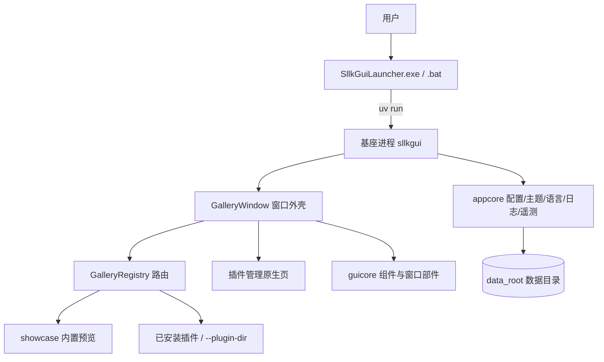
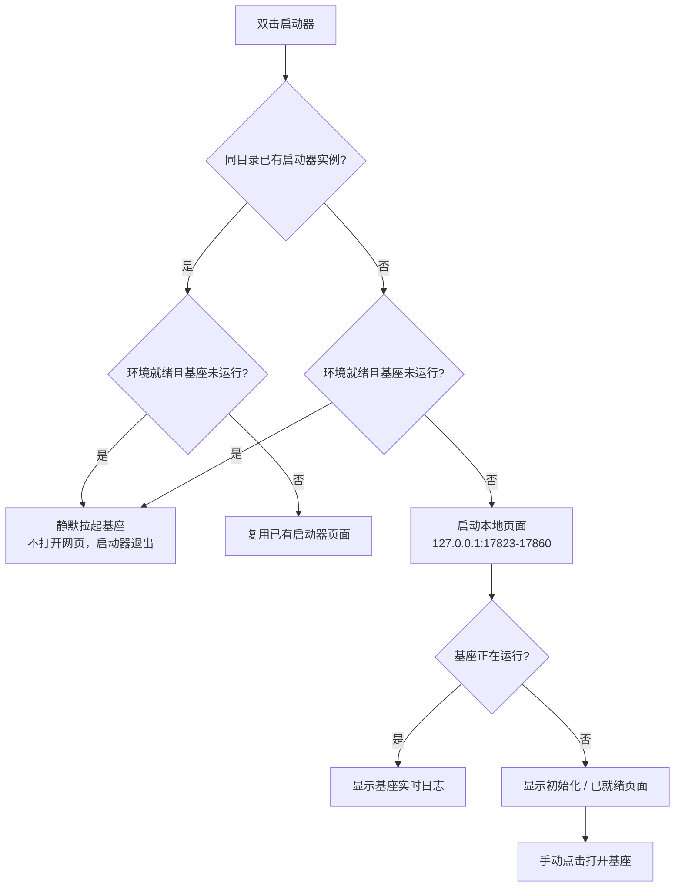
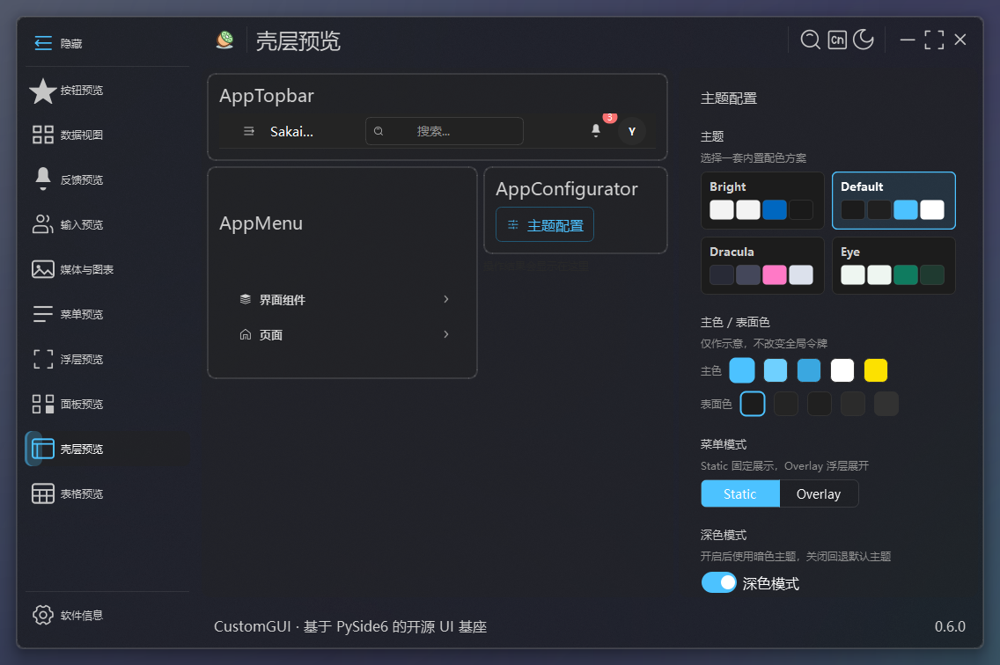
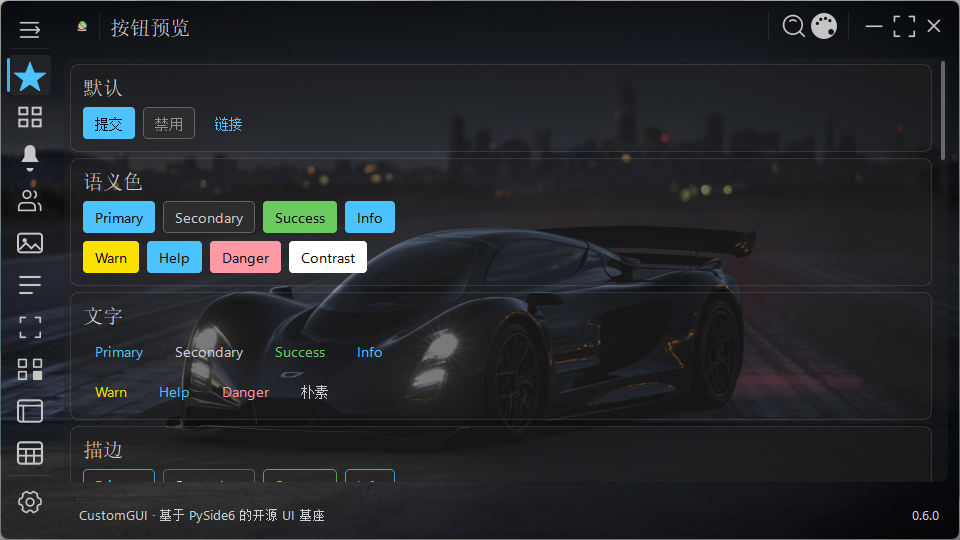
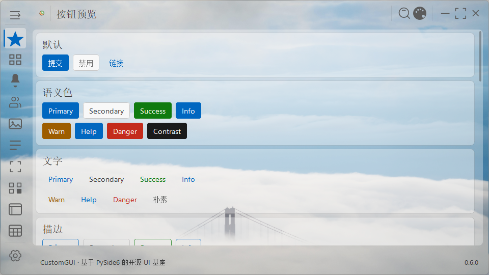
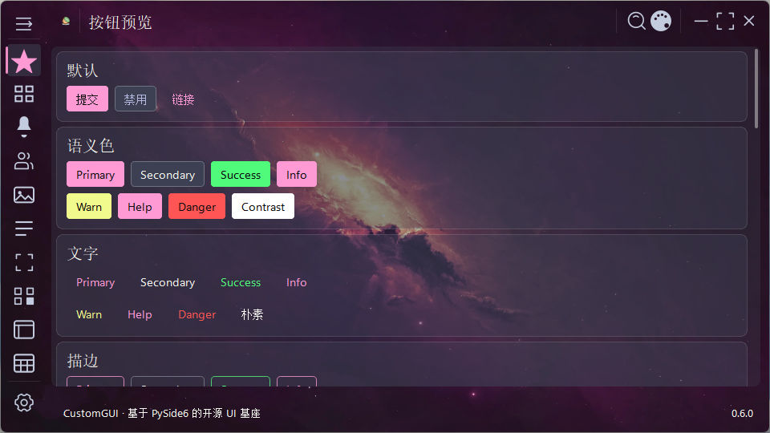
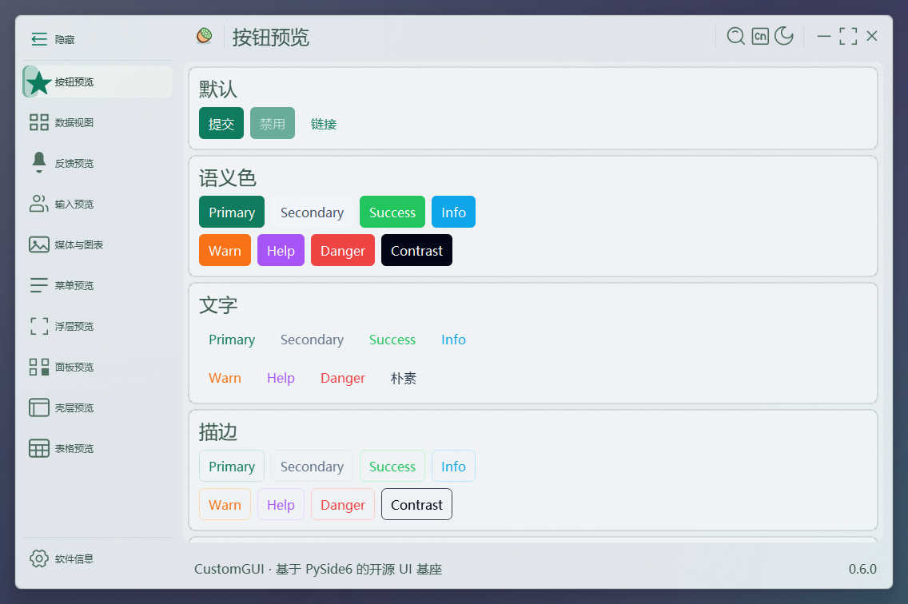

# SllkGUI · PySide6 桌面 UI 基座

基于 **PySide6** 的桌面 UI 基座：窗口骨架、设计令牌、组件库、主题与多语言、
插件运行时，以及一个「双击即用」的 Windows 启动器。

> 当前版本：**3.0.0**（tag `base-v3.0.0`）
>
> 2.0 起采用新的插件协议：**一个 Git 仓库 = 一个插件，插件可贡献多个 Surface**。
> 旧的 App 协议（`apps/`、`config.yml`、`plugins.yml`）已删除，不提供兼容层。

<p align="center">
  <a href="https://gitee.com/shilianlvke/SllkGui">Gitee</a> ·
  <a href="docs/README.md">文档索引</a> ·
  <a href="docs/ARCHITECTURE.md">架构</a> ·
  <a href="docs/PLUGIN.md">插件协议</a> ·
  <a href="docs/COMPONENTS.md">组件速查</a> ·
  <a href="docs/SETTINGS.md">设置系统</a> ·
  <a href="CHANGELOG.md">更新日志</a>
</p>

---

## 1. 项目简介

SllkGUI 既是一个可以直接运行的桌面应用外壳，也是一套给 PySide6 项目复用的 UI 基座。

它解决的是「桌面程序总要重写一遍」的那部分工作：

- 自定义无边框窗口：拖动、双击最大化、最小化/最大化/关闭、阴影、圆角、窗口缩放。
- 统一的视觉系统：设计令牌、主题、语义色、字体、间距、动画时长。
- 一套可复用的组件库：按钮、输入、表格、树、菜单、对话框、通知、图表等。
- 左侧菜单、独立设置窗口、顶部/底部抽屉、页面切换动画。
- 主题与语言切换，用户偏好自动保存。
- 插件发现、安装、更新、回滚、启停、卸载，以及插件依赖检查。
- 常驻系统托盘、统一的快捷键表（全局/局部作用域、平台修饰键、优先级与冲突检测）、
  日志与本地遥测事件。
- Windows 启动器：自动准备 uv、Python、Git，拉取基座源码，创建环境并启动。

### 1.1 整体结构



### 1.2 两个运行模式

| 模式 | 命令 | 加载内容 | 典型用途 |
| --- | --- | --- | --- |
| 正式模式 | `sllkgui run` | 已安装插件 + `--plugin-dir` 指定的本地插件 + 插件管理页 | 日常使用、运行 py-rm 等插件 |
| 预览模式 | `sllkgui gallery` | 内置 `showcase` 组件预览 + 插件管理页 | 组件验收、设计走查、离线演示 |

启动器默认选择**正式模式**；两种模式共用同一套窗口外壳和插件管理页，区别只在
「插件从哪里来」。预览模式不会读取已安装插件，也不会在启动时自动联网。

---

## 2. 环境要求

| 项目 | 要求 | 说明 |
| --- | --- | --- |
| 操作系统 | Windows 10 / 11 | 启动器仅在 Windows 上运行；基座核心代码可在其它桌面平台运行，亚克力材质会自动回落 |
| PowerShell | 5.1（Windows 自带） | `SllkGuiLauncher.bat` 依赖它 |
| uv | 任意较新版本 | 启动器检测不到时会自动下载便携版；从源码运行时请先安装 |
| Git | 任意较新版本 | 启动器检测不到时会自动下载 MinGit 便携版 |
| Python | 3.12 或更高 | 启动器通过 uv 管理 CPython 3.12，**不需要系统预装 Python** |
| 网络 | 可访问 Gitee 与 PyPI / 镜像站 | 首次初始化需要下载源码与依赖 |
| 管理员权限 | 不需要 | uv、Python、Git、基座源码都安装在启动器目录下 |

> 如果你只使用启动器，本机可以没有 Python、uv、Git：启动器会自己准备。
> 如果你要从源码开发，需要先安装 uv 与 Git。

---

## 3. 快速开始（推荐：使用启动器）

### 3.1 从发行版仓库获取启动器

启动器以独立文件分发，不在 Python 包内；本仓库只包含基座源码、资源与文档，
不包含启动器二进制。请从项目的**发行版仓库**获取 `SllkGuiLauncher.bat` 或
`SllkGuiLauncher.exe`（具体下载地址以发行版仓库页面为准）。

| 文件 | 版本形态 | 说明 |
| --- | --- | --- |
| `SllkGuiLauncher.bat` | **明文版** | 内容是可直接查看、搜索和修改的批处理 + PowerShell 脚本；适合审计、二次修改和排查问题 |
| `SllkGuiLauncher.exe` | **压缩版** | 把同一套启动逻辑压缩内嵌到单个 exe 中，体积更小；适合日常分发和双击使用 |

两者的功能、页面、初始化流程和运行目录一致：

- 双击任意一个即可启动，不需要命令行参数。
- 都会在**自己所在目录**下创建 `runtime\` 运行目录。
- 调用 uv / git / 基座时隐藏 PowerShell 与控制台窗口，不会留下常驻命令行。
- 都不会安装系统服务、写开机启动项或常驻后台。

> `SllkGuiLauncher.exe` 未做代码签名，Windows SmartScreen 可能提示「未知发布者」。
> 介意时可以直接使用明文 `SllkGuiLauncher.bat`，或先打开 bat 查看内容。

**放置位置**：把启动器放在与 `SllkGui` 目录**同级**的父目录中，例如：

```text
<发行版目录>\
├─ SllkGuiLauncher.bat      # 明文启动器
├─ SllkGuiLauncher.exe      # 压缩启动器（二选一）
├─ runtime\                 # 首次运行自动创建，不属于源码仓库
│  ├─ base\                 # 自动克隆的基座源码
│  ├─ tools\                # 便携版 uv / git
│  ├─ data\                 # 基座数据目录（配置、插件、日志）
│  ├─ logs\                 # 启动器日志
│  ├─ cache\                # 下载缓存
│  ├─ config.json           # 镜像源、模式等设置
│  └─ base-ref.json         # 当前基座版本记录
└─ SllkGui\                 # 本仓库（从源码仓库克隆）
```

> 启动器**不会复用**旁边的 `SllkGui\` 源码目录，而是独立维护 `runtime\base\`。
> 两者互不影响：你可以一边用启动器运行正式版，一边在本仓库里改源码。

启动器也可以放在任意可写目录。若所在目录不可写，运行目录会自动回退到
当前用户的本地应用数据目录。

### 3.2 首次初始化会做什么

首次双击启动器时，本机还没有 `runtime\`，启动器会：

1. 启动一个**只监听本机回环地址**的临时页面服务（端口 `17823`–`17860`）。
2. 用系统默认浏览器打开 `http://127.0.0.1:<端口>/`。
3. 页面显示「未就绪」，左侧列出 6 项初始化链路，主按钮是「开始初始化」。
4. 你可以在页面顶部先选好**运行模式**（正式 / 预览）和**镜像源**（国内镜像 / 官方源）。
5. 点击「开始初始化」后，依次执行：

| 步骤 | 做什么 | 完成后显示 |
| --- | --- | --- |
| 01 uv 包管理器 | 检测系统 uv；缺失则下载便携版到 `runtime\tools\uv` | 版本号 |
| 02 CPython 解释器 | 通过 uv 安装 CPython 3.12（不写注册表） | 版本号 |
| 03 Git 客户端 | 检测系统 Git；缺失则下载 MinGit 便携版到 `runtime\tools\git` | 版本号 |
| 04 基座源码 | 浅克隆远端最新的 `base-*` 版本标签到 `runtime\base` | 已拉取 |
| 05 虚拟环境 | 在 `runtime\base\.venv` 创建虚拟环境 | 已创建 |
| 06 依赖同步 | 用 `uv sync` 安装 PySide6 等运行依赖 | 已同步 |

初始化期间页面会持续输出实时日志，并显示已用时间；可以随时点「停止初始化」，
失败后可点「重试初始化」。

**需要多长时间？** 通常数分钟（常见 2–10 分钟）。主要耗时在下载 CPython、Git、
PySide6 及其依赖；网络慢或镜像不稳定时会更久。页面不会卡死，日志会实时滚动。

初始化完成后：

- 页面标题变为「已就绪」，左侧显示 `6 / 6`。
- 主按钮变为「打开基座」。
- **启动器不会自动打开基座**，需要你手动点击「打开基座」。
- 初始化产物都在 `runtime\` 下，不需要管理员权限。

### 3.3 日常启动：无感快速通道

初始化完成后，日常使用不需要再看到启动器页面：



这是设计行为，不是「双击没反应」。基座窗口出现后，启动器进程已经退出。

如果快速启动失败（例如环境文件损坏），启动器会回退到页面模式并显示错误，
方便你查看日志、重新初始化或更换版本。

### 3.4 基座运行中打开启动器：查看实时日志

当基座已经在运行时，再次双击启动器会打开管理页面，并进入「运行中」状态：

- 页面显示当前模式、基座 PID。
- 下方日志区标题变为「基座日志」，实时读取
  `runtime\data\logs\sllkgui.log`（取最新日志文件的末尾若干行）。
- 点「打开日志目录」会打开启动器的日志目录 `runtime\logs\`。
- 「退出启动器」只关闭启动器页面和本地服务，**不会关闭基座**。

如果检测到的基座是**从其它目录启动的实例**（不是本启动器拉起的），页面会显示：

> 检测到其他目录的基座实例 · PID xxxx，无法读取其日志。

此时日志区显示「外部基座实例，日志不可用」。关闭该实例后，用本启动器重新启动
即可恢复日志查看。

> 想主动打开启动器管理页（例如切换模式、切换版本）：
> 先让基座运行，再双击启动器打开页面；然后在系统托盘菜单里退出基座。
> 页面会从「运行中」回到「已就绪」，此时即可切换模式或更新版本。

### 3.5 启动器生命周期与约定

| 行为 | 结果 |
| --- | --- |
| 重复双击启动器 | 单实例。不同副本按所在目录隔离；同一副本会复用已有页面，或按快速通道直接拉起基座 |
| 退出启动器 | 只停止本地页面服务，**不关闭基座**；基座继续独立运行 |
| 关闭浏览器标签页 | 页面会通知启动器，通常在数秒内退出；初始化进行中会等初始化结束后退出 |
| 页面闲置 | 约 10 分钟没有请求时，启动器自动退出（基座不受影响） |
| 使用什么浏览器 | 系统默认浏览器，不内置浏览器内核 |
| 界面形态 | 单页面网页，无托盘图标、无开机自启、无系统服务 |
| 配置保存 | 模式、镜像源等写入 `runtime\config.json`，下次启动继续使用 |
| 基座独立性 | 基座可以脱离启动器运行；启动器退出不影响正在运行的基座 |

### 3.6 启动器页面上的功能

| 区域 | 功能 |
| --- | --- |
| 顶部「模式」 | 正式 / 预览切换；基座运行中禁止切换，按钮置灰 |
| 顶部「镜像源」 | 国内镜像 / 官方源切换；影响 uv、CPython、MinGit 和 PyPI 依赖下载 |
| 左侧「初始化链路」 | 6 项环境组件的状态与进度 |
| 主状态区 | 未就绪 / 初始化中 / 已就绪 / 运行中 / 初始化中断，以及主操作按钮 |
| 状态卡片 | 6 项组件的当前版本或状态摘要 |
| 版本栏 | 当前基座版本、短提交号、是否有更新、`main` 的 `DEV` 标记 |
| 「选择版本」 | 打开版本列表，可切换到某个 `base-*` 标签或 `main`；基座运行中、初始化中、更新中不可操作 |
| 实时日志 | 初始化 / 更新过程日志；基座运行时切换为基座日志 |
| 「打开日志目录」 | 打开 `runtime\logs\` |
| 「退出启动器」 | 关闭启动器，不关闭基座 |

首次克隆时，启动器会优先选择远端最新的 `base-*` 版本标签；找不到时才回落到
`main` 分支。版本列表中的 `main` 会标记为 `DEV`，表示开发分支，可能不稳定。

---

## 4. 从源码运行

适合开发、调试和自定义基座。

```powershell
git clone https://gitee.com/shilianlvke/SllkGui.git
cd SllkGui

# 安装运行依赖（uv 会自动创建 .venv 并安装项目）
uv sync

# 正式模式：加载已安装插件
uv run sllkgui run

# 预览模式：只加载内置组件预览
uv run sllkgui gallery
```

常用参数：

```powershell
# 打开指定页面：plugin_id/surface_id
uv run sllkgui run --surface com.shilianlvke.pyrm/home

# 不加载任何外部插件，只保留基座与插件管理页
uv run sllkgui run --safe-mode

# 直接加载本地插件目录，不写入插件注册表
uv run sllkgui run --plugin-dir ..\my-plugin

# 指定数据目录（配置、插件、日志都会写到这里）
uv run sllkgui run --data-dir .\mydata

# 指定 PyPI 镜像源（用于自动安装插件依赖）
uv run sllkgui run --index-url https://pypi.tuna.tsinghua.edu.cn/simple
```

安装为其它项目的依赖：

```powershell
uv add "sllkgui @ git+https://gitee.com/shilianlvke/SllkGui.git@base-v3.0.0"
```

运行环境要求：Python 3.12+、PySide6 6.10.1+、PyYAML 6.0.3+、packaging 24+。

---

## 5. 两种模式的切换

### 5.1 用启动器切换

1. 打开启动器页面。
2. 在顶部「模式」中选择「正式」或「预览」。
3. 选择会立即保存到 `runtime\config.json`。
4. 之后点击「打开基座」，启动器会以所选模式启动。

基座运行中不能切换模式，按钮会置灰并提示「运行中不可切换」。请先在托盘菜单
退出基座，再切换。

### 5.2 用命令行切换

```powershell
uv run sllkgui run       # 正式模式
uv run sllkgui gallery   # 预览模式
```

### 5.3 模式差异速查

| 能力 | 正式模式 `run` | 预览模式 `gallery` |
| --- | --- | --- |
| 已安装插件 | 加载 | 不加载 |
| `--plugin-dir` 本地插件 | 加载 | 不加载 |
| 内置组件预览 | 不加载 | 加载 |
| 插件管理页 | 常驻 | 常驻 |
| 启动时自动联网 | 否 | 否 |
| 适合场景 | 日常使用、运行 py-rm | 组件验收、设计走查、离线演示 |

---

## 6. 目录结构

```text
SllkGui/
├─ src/sllkgui/
│  ├─ appcore/              # 配置、主题、语言、日志、遥测、用户设置
│  ├─ guicore/              # 组件库、设计令牌、窗口部件、亚克力材质
│  ├─ gallery/              # 插件协议、源、安装、加载、运行时、托盘、快捷键
│  ├─ guis/                 # 基座窗口装配与原生页面（插件管理）
│  ├─ showcase/             # 内置组件预览（gallery 模式）
│  ├─ _resources/           # 默认主题、语言、图标、settings YAML
│  ├─ cli.py                # 命令行入口
│  ├─ config.py             # configure() / current_config()
│  ├─ plugin.py             # 插件作者公开 API
│  └─ window.py             # 窗口与 Gallery 门面
├─ examples/
│  ├─ plugin-hello/         # 最小合规插件
│  └─ source-template/      # 最小插件源仓库模板
├─ docs/                    # 架构、插件、组件、API、托盘、快捷键等文档
├─ scripts/                 # 打包、发布、校验脚本
├─ tests/                   # pytest 测试
├─ settings/                # 运行时生成的用户配置（gitignore）
├─ gallery/                 # 运行时生成的插件目录（gitignore）
├─ logs/                    # 运行时生成的日志（gitignore）
├─ pyproject.toml
├─ uv.lock
├─ CHANGELOG.md
└─ README.md
```

---

## 7. 主要功能与组件

### 7.1 窗口与外观

- 无边框窗口，保留拖动、双击标题栏最大化/还原、最小化、最大化、关闭。
- 窗口阴影、圆角、边框、缩放手柄，最大化和亚克力模式下自动铺满。
- Windows 11 亚克力（Acrylic）材质，其它平台自动回落到不透明主题底色。
- 背景图片，支持 `fill` / `fit` / `stretch` / `tile` / `center` 五种适应模式。
- 左菜单、独立设置窗口、顶部/底部抽屉。
- 菜单与抽屉支持 `static`（占位）和 `overlay`（浮层）两种模式。
- 页面切换动画，时长可在 `settings/window.yaml` 中调整。
- 标题栏搜索：按页面标题实时过滤并跳转。
- 窗口正常关闭时保存尺寸，下次启动恢复，且不会小于配置的最小尺寸。

### 7.2 统一设置窗口

标题栏「设置」或 `primary+,` 打开独立设置窗口（宽高为主界面的 80%，居中，
单层表面无内层卡片，右上角仅保留关闭按钮）。基座按能力分类，插件按插件
分组，全部使用同一套声明模型与保存语义：

- **外观**：主题卡片、窗口透明度、亚克力质感、背景图与适应模式。
- **界面**：语言、左菜单模式、抽屉模式（`static` / `overlay`）。
- **启动与窗口**：记住窗口尺寸，当前 / 最小 / 启动尺寸只读信息。
- **快捷键**：基座与插件绑定按 owner 分组、冲突计数。
- **关于**：版本、运行环境、目录与配置存储位置。
- **插件设置**：插件在 `on_load` 里调用 `ctx.settings.define(...)` 声明，
  自动出现在左侧「插件设置」分组；没有声明的插件显示「未声明」空状态。

编辑先进草稿，底部操作栏显示未保存数量；保存后按命名空间写入。主题 / 材质 /
背景实时预览，放弃或关闭时按基线还原。配置键带命名空间，不会互相覆盖：

| 来源 | 完整键 | 存储 |
| --- | --- | --- |
| 基座 | `core.appearance.theme` | `<data_root>/settings/user.yaml` |
| 插件 | `plugin.<plugin_id>.<key>` | `<data_root>/settings/plugins/<plugin_id>.yaml` |

详见 [docs/SETTINGS.md](docs/SETTINGS.md)；高保真原型见
[docs/prototype/settings-window.html](docs/prototype/settings-window.html)。

### 7.3 组件库

`sllkgui.guicore` 提供由设计令牌驱动的组件，主题切换后重绘即生效。常用分类：

| 分类 | 组件示例 |
| --- | --- |
| 按钮 | `CButton` `CButtonGroup` `CSplitButton` `CStatusButton` `CMenuButton` `CToggleButton` |
| 输入与选择 | `CInputText` `CTextarea` `CInputNumber` `CSelect` `CComboBox` `CMultiSelect` `CDatePicker` `CColorPicker` `CSlider` `CKnob` `CCheckbox` `CRadioButton` `CToggleSwitch` |
| 数据 | `CDataTable` `CPaginator` `CDataView` `CTree` `CTreeTable` `CTimeline` |
| 菜单 | `CMenu` `CMenubar` `CTieredMenu` `CPanelMenu` `CContextMenu` `CTabMenu` `CStepper` |
| 展示 | `CCard` `CPanel` `CBadge` `CChip` `CTag` `CAvatar` `CImage` `CProgressBar` `CSkeleton` `CBreadcrumb` `CSteps` |
| 浮层与反馈 | `CDialog` `CConfirmDialog` `CConfirmPopup` `CToolTip` `CMessage` `CToast` |
| 文件与图表 | `CFileUpload` `CChart` |
| 布局 | `CTabs` `CAccordion` `CFieldset` `CFormField` `CFormGrid` `CScrollArea` `CSplitter` `CToolbar` |
| 设置与导航 | `CSettingsWindow` `CSideNav` `CSettingGroup` `CSettingRow` `CInfoRow` `CEditActionBar` `CThemeCard` `CThumbnail` |
| 窗口部件 | `CWindow` `CTitleBar` `CLeftMenu` `CSettingsWindow` `CGrips` `CCredits` |

界面效果（内置预览插件的实拍）：

| 概览 | 默认主题 |
| --- | --- |
|  |  |

| 明亮主题 | 梦幻主题 | 护眼主题 |
| --- | --- | --- |
|  |  |  |

完整签名与用法见 [docs/COMPONENTS.md](docs/COMPONENTS.md)。

### 7.4 托盘

- 基座启动后创建唯一系统托盘图标，插件不能替换图标或悬停提示。
- 关闭主窗口时默认隐藏到托盘，插件与桌面小部件继续运行。
- 菜单三层：**槽（quick / tools / status）→ 插件块 → 动作**；插件只声明
  「属于哪个槽、排多前」，内联还是子菜单由基座裁决。
- 槽内只有 1 个插件时全部内联；出现第二个插件时各块收进同名子菜单，
  插件再多也不会退化成平铺混排。
- 溢出兜底：quick 5 条、tools 7 行、status 3 条、单插件 12 条动作；超出的
  动作降级到 tools、收进「更多插件 ▸」或截断，顶层最多 18 行。
- 基座固定项（显示主窗口 / 设置… / 退出）永远在最后，插件无法写入。
- 菜单由基座自绘（`CPopupMenu`，不继承 `QMenu`）：单窗口多面板、按主题着色、
  自己画子菜单箭头、贴边自动向左翻转、超屏可滚动。
- 系统托盘不可用时自动降级：关闭主窗口直接退出。

详见 [docs/TRAY.md](docs/TRAY.md)、组件文档 [docs/POPUP_MENU.md](docs/POPUP_MENU.md)，
交互原型见 `docs/prototype/tray-menu.html`。

### 7.5 快捷键

- 基座在 `QApplication` 上装唯一事件过滤器，内置功能与插件注册到同一张表。
- 支持 `global` / `local` 作用域、`primary` 平台修饰键、优先级与冲突策略。
- 内置：`primary+k` 打开页面搜索，`primary+,` 打开设置窗口（锁定，插件不可覆盖）。
- 插件通过 `ctx.shortcuts` 注册（需 `shortcuts` 权限），卸载时由加载器统一清理。

详见 [docs/SHORTCUTS.md](docs/SHORTCUTS.md)。

### 7.6 日志与遥测

- 运行日志：`<data_root>/logs/sllkgui.log`，1 MB × 5 滚动。
- 遥测事件：`<data_root>/logs/diagnostics/events.jsonl`。
- 指标聚合：`<data_root>/logs/diagnostics/metrics.json`。
- 遥测只写本地文件，不上传网络。
- 插件通过 `ctx.log()` / `ctx.event()` / `ctx.timing()` 接入基座日志与遥测，
  不需要自己配置 logging。

---

## 8. 依赖说明

### 8.1 运行时依赖

| 依赖 | 版本要求 | 用途 |
| --- | --- | --- |
| Python | `>=3.12` | 运行时 |
| PySide6 | `>=6.10.1,<7` | Qt 窗口、控件、图形 |
| PyYAML | `>=6.0.3,<7` | 配置、主题、语言、插件清单 |
| packaging | `>=24` | 版本解析与依赖判断 |

### 8.2 开发依赖

```powershell
uv sync --extra dev
```

包含 `pytest`、`pytest-qt`、`pytest-cov`、`mypy`、`ruff`、`black`、
`pyinstaller`、`build`、`twine`。

### 8.3 启动器依赖

- Windows PowerShell 5.1（系统自带）。
- 首次初始化时自动准备 uv、CPython 3.12、MinGit。
- 不依赖系统 Python、pip 或管理员权限。
- 启动器本身不内置浏览器，使用系统默认浏览器展示页面。

---

## 9. 配置说明

### 9.1 数据目录 `data_root`

`data_root` 是运行期可写数据根目录，配置、插件、日志都放在这里。

| 运行方式 | 默认 `data_root` |
| --- | --- |
| 源码 `uv run sllkgui ...` | 仓库根目录（存在 `pyproject.toml` 的那一层） |
| 启动器启动 | `<启动器目录>\runtime\data` |
| 打包后的程序 | 可执行文件所在目录 |

覆盖优先级：**显式 `configure(data_dir=...)` / `--data-dir` > 环境变量 > 默认值**。

```powershell
uv run sllkgui run --data-dir .\mydata
```

也可以设置环境变量：

```powershell
$env:SLLKGUI_DATA_DIR = ".\mydata"
uv run sllkgui run
```

### 9.2 用户配置 `user.yaml`

用户偏好写入：

```text
<data_root>\settings\user.yaml
```

启动器模式下就是：

```text
runtime\data\settings\user.yaml
```

该文件只记录**改动过的键**，缺失的字段继续使用基座默认值。支持字段：

| 字段 | 取值 | 说明 |
| --- | --- | --- |
| `theme_name` | `default` / `bright` / `dracula` / `eye` | 主题 |
| `language` | `zh_cn` / `zh_tw` / `en_us` / `ja_jp` | 语言 |
| `menu_mode` | `static` / `overlay` | 左菜单模式 |
| `drawer_mode` | `static` / `overlay` | 抽屉模式 |
| `startup_size` | `[宽, 高]` | 启动窗口尺寸 |
| `acrylic_transparency` | `0`–`100` | 亚克力透明度 |
| `glass_strength` | `0`–`100` | 玻璃质感强度 |
| `background_image` | 图片路径 | 背景图 |
| `background_fit` | `fill` / `fit` / `stretch` / `tile` / `center` | 背景适应模式 |
| `background_recent` | 路径列表 | 最近使用的背景图（最多 5 个） |

默认窗口尺寸与最小尺寸在 `src/sllkgui/_resources/sllkgui/settings/window.yaml`
中定义，当前默认最小尺寸为 `1440 × 900`。品牌层可以通过自己的资源目录逐键覆盖。

### 9.3 基座默认配置

随包发布的只读默认值位于：

```text
src/sllkgui/_resources/sllkgui/
├─ settings/
│  ├─ config.yaml        # 语言、主题、Logo
│  ├─ window.yaml        # 窗口、菜单、抽屉、动画、亚克力、字体
│  ├─ components.yaml    # 组件几何、动画、阈值
│  └─ console.yaml       # 日志级别、颜色、日志文件策略
├─ themes/               # default / bright / dracula / eye
└─ languages/            # zh_cn / zh_tw / en_us / ja_jp
```

应用可以通过 `sllkgui.configure(resource_dirs=[...])` 或 `SLLKGUI_RESOURCE_DIR`
叠加自己的品牌资源，同名文件按层深度合并，未覆盖的键继续由基座提供。

### 9.4 启动器配置

启动器设置保存在：

```text
<启动器目录>\runtime\config.json
```

默认值：

| 字段 | 默认值 | 说明 |
| --- | --- | --- |
| `mirror` | `cn` | `cn` 国内镜像；`global` 官方源 |
| `repo` | `https://gitee.com/shilianlvke/SllkGui.git` | 基座仓库 |
| `branch` | `main` | 未找到 `base-*` 标签时的回落分支 |
| `python` | `3.12` | 初始化使用的 CPython 版本 |
| `mode` | `run` | `run` 正式模式；`gallery` 预览模式 |

一般只需要在页面上切换镜像源和模式；`repo` / `branch` / `python` 供高级场景手动修改。

### 9.5 日志位置

| 日志 | 位置 | 内容 |
| --- | --- | --- |
| 基座运行日志 | `<data_root>\logs\sllkgui.log` | 基座与插件日志，1 MB × 5 滚动 |
| 启动器日志 | `runtime\logs\launcher.log` | 启动器启动、退出、端口 |
| 基座标准输出 | `runtime\logs\app.out.log` | 启动器拉起基座时的 stdout |
| 基座标准错误 | `runtime\logs\app.err.log` | 启动器拉起基座时的 stderr |
| 遥测事件 | `<data_root>\logs\diagnostics\events.jsonl` | 本地事件流 |
| 遥测指标 | `<data_root>\logs\diagnostics\metrics.json` | 事件计数聚合 |

启动器页面「打开日志目录」打开的是 `runtime\logs\`；基座业务日志在
`runtime\data\logs\sllkgui.log`。

### 9.6 常用环境变量

| 变量 | 作用 |
| --- | --- |
| `SLLKGUI_DATA_DIR` | 覆盖数据根目录 |
| `SLLKGUI_GALLERY_DIR` | 覆盖插件安装根目录 |
| `SLLKGUI_DIAGNOSTICS_DIR` | 覆盖遥测目录 |
| `SLLKGUI_RESOURCE_DIR` | 叠加品牌资源目录（其下包含 `resource\` 时自动识别） |
| `SLLKGUI_ROOT_DIR` | 兼容旧版的资源覆盖根目录 |
| `SLLKGUI_PROGRAM_DIR` | 覆盖程序运行根目录 |
| `SLLKGUI_PIP_INDEX_URL` | 插件依赖自动安装使用的 PyPI 镜像 |
| `SLLKGUI_BUILTIN_MENUS` | 是否启用内置菜单 |

---

## 10. 插件机制概述

### 10.1 基本模型

- **一个 Git 仓库 = 一个插件**。
- 插件通过一个或多个 **Surface** 向基座贡献页面。
- 路由键为 `plugin_id/surface_id`。
- 插件代码运行在宿主进程内；清单里的权限用于安装前知情同意，不是沙箱。
- 插件失败会被隔离，不影响其它插件和基座本身。


插件仓库最小结构：

```text
my-plugin/
├─ sllkgui-plugin.yml          # 运行时清单
├─ plugin.py                   # 导出 PLUGIN 实例
├─ pages/                      # 可选：页面实现
└─ resource/
   ├─ icon/*.svg
   └─ lang/{zh_cn,zh_tw,en_us,ja_jp}.yml
```

清单示例：

```yaml
schema: 1
api: 1
id: com.example.notes
name: Notes
version: 1.2.0
description: 通用便签
license: MIT
entry: plugin.py
requires:
  sllkgui: ">=3.0.0,<4.0.0"
  python: ">=3.12"
surfaces:
  - id: notes
    title: {zh_cn: 便签, zh_tw: 便籤, en_us: Notes, ja_jp: ノート}
    icon: resource/icon/notes.svg
    impl: pages/notes.py
    default: true
    order: 10
permissions:
  - filesystem.write
```

`impl` 是该 Surface 的页面实现文件路径（相对插件根目录）。声明后基座在加载期就
校验文件存在，缺失时跳过整个插件并记 `PLUGIN_SURFACE_IMPL_MISSING`，而不是等到
用户点击时才报错。

插件内部一律用**相对导入**（`from .pages.notes import NotesPage`）：基座不会把
插件目录加入 `sys.path`，否则插件里的同名模块会遮蔽标准库、劫持全进程。

入口示例：

```python
from sllkgui.plugin import GalleryContext, Plugin


def build_home(ctx: GalleryContext):
    from PySide6.QtWidgets import QLabel
    return QLabel(ctx.text("home.title", "Hello"))


class MyPlugin(Plugin):
    def on_load(self, ctx: GalleryContext) -> None:
        self.ctx = ctx
        ctx.log("loading")
        ctx.event("plugin.ready")

    def surfaces(self):
        return {"home": build_home}

    def on_unload(self) -> None:
        self.ctx.log("unloading")


PLUGIN = MyPlugin()
```

### 10.2 插件管理页

正式模式和预览模式都会常驻「插件管理」原生页面，包含三个工作区：

- **已安装**：查看、启用、停用、更新、回滚、卸载。
- **发现**：搜索源仓库中的插件并安装。
- **源**：添加、刷新、移除插件源。

基座首次运行会登记官方源
`https://gitee.com/shilianlvke/sllkgui-source.git`，但不会自动刷新；在「源」页
刷新后即可在「发现」中搜索。

### 10.3 命令行管理插件

```powershell
# 官方源会在首次运行时自动登记，直接刷新即可
uv run sllkgui source list
uv run sllkgui source refresh official

# 搜索、安装、查看
uv run sllkgui plugin search
uv run sllkgui plugin install com.shilianlvke.pyrm --yes
uv run sllkgui plugin list --json

# 更新、回滚、启停、卸载
uv run sllkgui plugin update com.shilianlvke.pyrm
uv run sllkgui plugin rollback com.shilianlvke.pyrm
uv run sllkgui plugin disable com.shilianlvke.pyrm
uv run sllkgui plugin remove com.shilianlvke.pyrm --yes

# 校验与开发检查
uv run sllkgui plugin verify
uv run sllkgui plugin lint ..\my-plugin
uv run sllkgui plugin doctor
```

### 10.4 插件存储布局

```text
<data_root>/gallery/
├─ registry.json
├─ sources.json
├─ sources/<source_id>/       # 源仓库浅克隆
├─ plugins/<plugin_id>/       # 当前安装版本
├─ history/<plugin_id>/       # 上一版本（回滚）
├─ data/<plugin_id>/          # 插件 ctx.data_dir
├─ cache/<plugin_id>/         # 插件缓存
├─ staging/                   # 安装临时目录
└─ trash/                     # 卸载回收站
```

`gallery` 模式不读取这些目录。完整协议见
[docs/PLUGIN.md](docs/PLUGIN.md)、[docs/PLUGIN_STANDARD.md](docs/PLUGIN_STANDARD.md)
和 [docs/GALLERY.md](docs/GALLERY.md)。

---

## 11. 常见问题与排错

### Q1. 双击启动器后什么都没出现？

如果环境已经初始化完成，且基座没有运行，这通常就是**无感快速启动**：

1. 启动器不打开网页，直接拉起基座后退出。
2. 检查任务栏、Alt+Tab 或系统托盘，基座窗口可能已经在运行。
3. 如果任务管理器里也没有基座进程，打开启动器页面查看错误和日志。

> 想强制看到启动器页面：先让基座运行，再双击启动器。

### Q2. 页面显示「外部基座实例，日志不可用」

说明正在运行的基座不是本启动器拉起的，或者它来自另一个目录。启动器只能读取
`runtime\data\logs\` 下的日志。

处理方式：在托盘菜单退出该基座，再用本启动器重新启动。

### Q3. 初始化失败或一直很慢

1. 在页面日志区查看最后一条 `ERR` / `WARN`。
2. 点「打开日志目录」，查看 `runtime\logs\launcher.log`。
3. 切换到「官方源」或「国内镜像」后重试；不同网络环境适用不同镜像。
4. 确认可以访问 Gitee 与 PyPI（或对应镜像）。
5. 确认磁盘空间充足。
6. 点「重试初始化」；仍然失败时，关闭基座与启动器后重新打开。

### Q4. 打开基座后没有插件

正式模式只加载**已安装**的插件。首次使用需要：

1. 打开左侧「插件管理」。
2. 进入「源」，刷新官方源。
3. 进入「发现」，搜索并安装插件。
4. 回到「已安装」确认插件已启用。

### Q5. 安装插件时提示缺少 Python 依赖

按提示选择自动安装即可；基座会通过 uv 把依赖安装到当前虚拟环境。也可以手动：

```powershell
uv run sllkgui run --index-url https://pypi.tuna.tsinghua.edu.cn/simple
```

如果插件安装失败，基座会隔离该插件并记录
`PYTHON_DEPENDENCY_MISSING` / `PYTHON_DEPENDENCY_INSTALL_FAILED`。

> **打包后的冻结形态例外**：若基座以 PyInstaller 等方式打包，`sys.executable`
> 指向打包产物而非 Python 解释器，无法安装任何依赖。此时基座会直接报
> `FROZEN_ENV_UNSUPPORTED` 并跳过该插件。可行做法：让插件把依赖内置到
> `vendor/` 随仓库分发、由宿主在启动前自行安装，或改用源码分发形态
> （启动器会 bootstrap 出真实 venv）。

### Q6. 预览模式为什么看不到已安装插件？

这是设计行为。`gallery` 模式只加载内置 `showcase`，用于组件验收和设计走查，
不会读取已安装插件。需要插件时请切换到正式模式。

### Q7. 关闭主窗口后程序不见了

基座默认隐藏到系统托盘，而不是退出。请在托盘图标菜单中选择「显示主窗口」或
「退出」。如果系统托盘不可用，关闭主窗口会直接退出。

### Q8. 启动器页面打不开，或提示端口被占用

启动器使用 `127.0.0.1` 的 `17823`–`17860` 端口。全部被占用时会启动失败。

处理方式：关闭占用这些端口的本地程序，或重启电脑后重试。

### Q9. 窗口太大 / 屏幕放不下

基座默认最小窗口尺寸为 `1440 × 900`。在更小的屏幕上可能显示不完整。
可以通过品牌资源层覆盖 `settings/window.yaml` 中的 `minimum_size`，或使用
更高分辨率的显示器。

### Q10. 如何完全重置启动器环境？

关闭基座和启动器后，重命名或删除启动器目录下的 `runtime\`，下次双击会重新
初始化。

> 注意：`runtime\data\` 里包含用户配置、已安装插件和插件数据，删除后无法恢复。
> 只想重置环境、保留插件时，请先备份 `runtime\data\`。

### Q11. SmartScreen 或杀毒软件提示风险

`SllkGuiLauncher.exe` 未做代码签名，可能触发 SmartScreen。可以：

- 选择「更多信息」→「仍要运行」；或
- 直接使用明文 `SllkGuiLauncher.bat`，先打开查看内容再运行。

---

## 12. 开发与质量门禁

```powershell
uv sync --extra dev

uv run ruff check src tests examples scripts
uv run ruff format --check src tests examples scripts
uv run mypy
uv run pytest --cov=sllkgui --cov-fail-under=70
```

### 提交前门禁（pre-commit）

把上面的命令前移到本地，避免「忘了跑」。装一次即可：

```powershell
uv run pre-commit install
```

之后每次 `git commit` 会自动执行：ruff lint、ruff format、mypy、文件卫生检查
与一组快速冒烟用例。想手工跑全量：

```powershell
uv run pre-commit run --all-files
```

钩子全部使用本地实现（`language: system`），不联网拉取第三方仓库。

### 代码风格

格式由 `ruff format` 统一（与 ruff lint 同源，零额外依赖）。仓库里的
`.editorconfig` 固定了换行符、缩进与末尾换行；资源文件（SVG 等）不参与
格式化与卫生检查。

### 类型标注的承诺范围

包内带 `py.typed`，因此下游的类型检查器会读取本包的注解。需要注意的是，
**承诺是分层的**：

| 范围 | 类型保证 |
| --- | --- |
| `sllkgui.plugin` / `sllkgui.window` | 完整。插件作者的唯一入口，纳入 mypy 门禁 |
| `sllkgui.gallery.api` 等插件协议 | 完整。协议本身纳入门禁 |
| `sllkgui.appcore.settings` 设置 schema | 完整。插件声明设置页用的全部类型 |
| `guicore` 组件库实现 | **不承诺**。运行期行为正确，但注解完备度不保证 |

也就是说：你在插件里对 `GalleryContext`、`Setting`、`SettingsPage` 等类型做
严格检查是可靠的；对 `guicore` 内部实现（如某个 `QWidget` 子类的私有属性）
不要依赖 mypy 的推断。

组件库之所以不在门禁内：它的历史欠账主要是 PySide6 类型存根的缺口
（`Qt.UserRole` 这类）与未声明的实例属性，属于注解补全而非真实缺陷，
一次性收敛到零不现实。门禁范围写在 `pyproject.toml` 的 `[tool.mypy]` 里，
新增模块时请一并考虑。

常用工具：

```powershell
# 生成插件模板
uv run sllkgui scaffold ..\my-plugin --id com.example.my-plugin --name "My Plugin"

# 生成源仓库模板
uv run sllkgui scaffold ..\my-source --source

# 诊断路径、工具与插件状态
uv run sllkgui doctor
uv run sllkgui doctor --json
```

更多文档：

| 文档 | 内容 |
| --- | --- |
| [docs/ARCHITECTURE.md](docs/ARCHITECTURE.md) | 分层、包地图、启动时序、扩展点 |
| [docs/PLUGIN.md](docs/PLUGIN.md) | 插件协议、清单、Surface、生命周期 |
| [docs/PLUGIN_STANDARD.md](docs/PLUGIN_STANDARD.md) | 插件开发规范 |
| [docs/COMPONENTS.md](docs/COMPONENTS.md) | 组件分类、签名、设计令牌 |
| [docs/API.md](docs/API.md) | 配置、主题、语言、插件、遥测 API |
| [docs/GALLERY.md](docs/GALLERY.md) | Gallery 命令、存储、加载流程 |
| [docs/SOURCE.md](docs/SOURCE.md) | 源仓库协议 |
| [docs/TRAY.md](docs/TRAY.md) | 托盘所有权与插件动作 |
| [docs/POPUP_MENU.md](docs/POPUP_MENU.md) | 自绘弹出菜单：接口、交互、边界与 QMenu 迁移 |
| [docs/SHORTCUTS.md](docs/SHORTCUTS.md) | 快捷键作用域、优先级与插件协议 |
| [docs/contributing.md](docs/contributing.md) | 贡献指南 |

---

## 13. 相关项目

| 项目 | 说明 |
| --- | --- |
| [py-rm](https://gitee.com/shilianlvke/py-rm) | 基于 SllkGUI Gallery 的桌面小部件运行时插件 |
| [sllkgui-source](https://gitee.com/shilianlvke/sllkgui-source) | 官方插件源（只存元信息，不存插件代码） |

---

## 14. 许可证

本项目使用 [MulanPSL-2.0](LICENSE) 许可证。

欢迎通过 issue / PR 提交插件、组件和改进。
