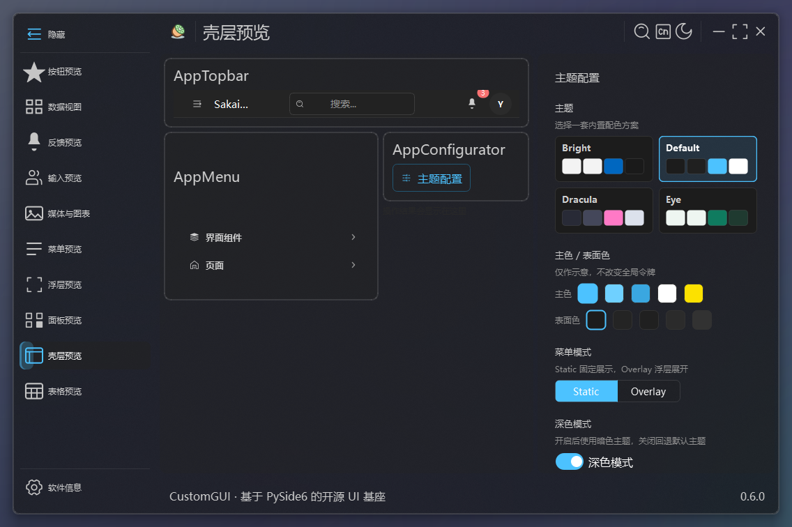
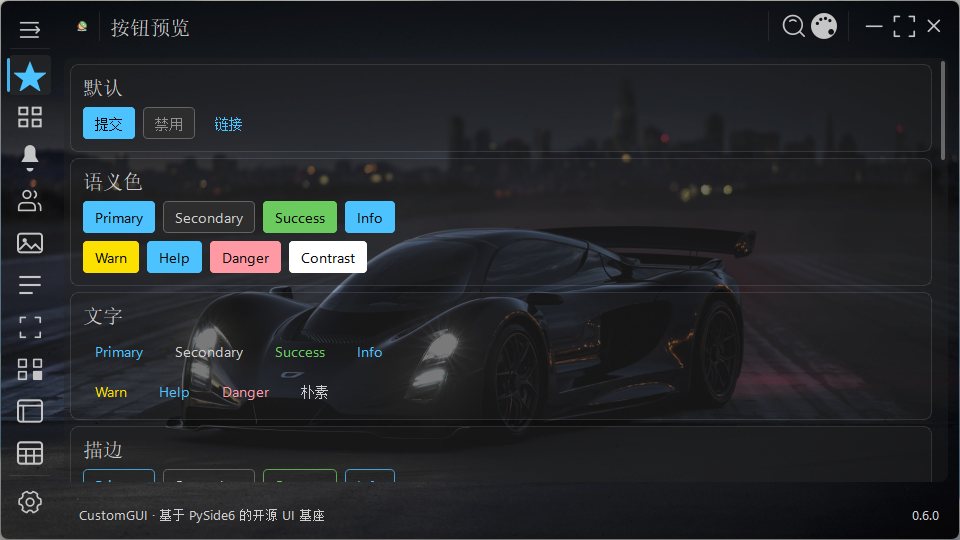
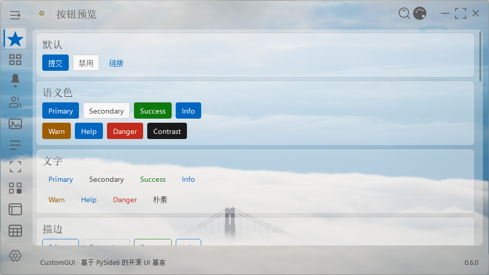
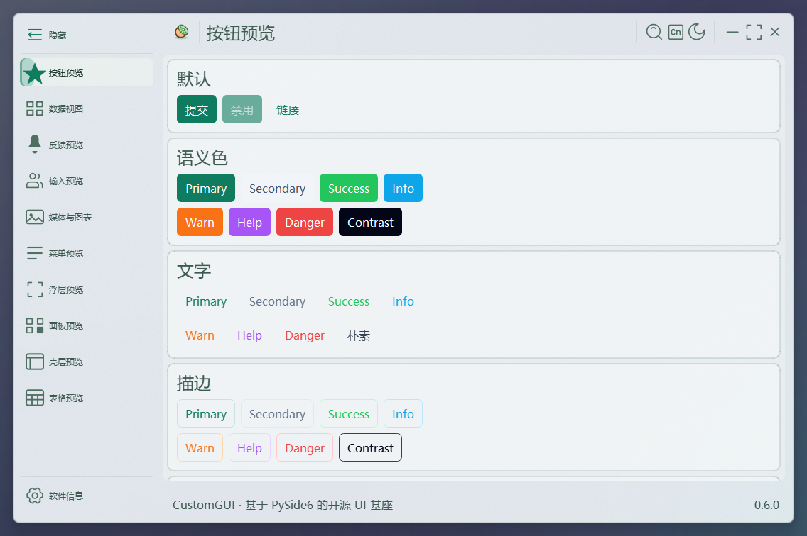
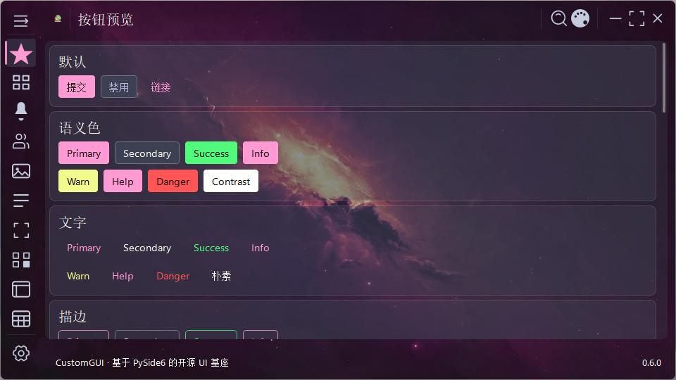

# SllkGUI · PySide6

<p align="center">
  
</p>

<p align="center">
  基于 <b>PySide6</b> 的桌面 UI 基座：窗口骨架、设计令牌、组件库、主题与语言、目录即插件。
</p>

<p align="center">
  <a href="https://gitee.com/shilianlvke/SllkGui">Gitee</a> ·
  <a href="https://github.com/shilianlvke/SllkGui">GitHub</a> ·
  <a href="docs/README.md">文档</a> ·
  <a href="docs/ARCHITECTURE.md">架构</a> ·
  <a href="docs/PLUGIN.md">插件协议</a> ·
  <a href="CHANGELOG.md">更新日志</a>
</p>

---

> **版本 1.0.0**
>
> 本仓库当前版本 `1.0.0`，尚未发布到 PyPI，通过源码、wheel 与 git tag 分发。
> 1.x 期间的约束：
>
> - 公开 API 以 `__all__` 为准，`1.x` 内保持向后兼容；破坏性变更只在新的 major 版本引入，并记录在 [CHANGELOG](CHANGELOG.md)。
> - 主要验证环境是 **Windows + Python 3.12 + PySide6 6.10**；其他平台可用但未纳入回归。
> - 发现的问题请提 issue，并附上 `sllkgui doctor` 的完整输出——它比「窗口是黑的」有用得多；`doctor` 默认不执行应用代码。

---

## 这个项目是什么

一个**能被别的项目当依赖装进去**的桌面 UI 基座，而不是脚手架或组件库 demo。它提供：

- **窗口骨架**：无边框圆角窗口、Windows 11 亚克力材质（不可用时自动回退不透明）、自绘标题栏、可折叠左菜单、左右/顶底四向栏目抽屉（统一支持固定占位 / 浮层覆盖两种模式）、底部版权栏、拖拽缩放。
- **设计令牌**：颜色/字体/间距/圆角/尺寸集中在 `DesignTokens`，QSS 与自绘组件共用同一套值，切换主题即时生效。
- **组件库**：`sllkgui.guicore` 导出 126 个公开名，其中 `custom_ui` 91 个组件 + 3 个模型/枚举、`window` 12 个窗口部件、`acrylic` 7 个材质工具。
- **主题与语言**：内置 4 套主题（default / bright / eye / dracula）、4 种语言（zh_cn / zh_tw / en_us / ja_jp），主题、语言、菜单模式、四向抽屉模式与深色模式统一收进右侧“外观配置”抽屉，标题栏色盘图标为唯一入口，支持应用级品牌覆盖。用户改动自动写入数据目录下的 `settings/user.yaml`，下次启动优先于品牌层与基座默认值恢复。
- **目录即插件**：把页面放进 `apps/<name>/`，启动时自动发现、注册左侧菜单、懒加载页面；应用自带图标、语言与品牌资源。
- **可诊断**：分层错误边界、结构化遥测事件、`sllkgui doctor` 一条命令打印全部路径与发现结果。

## 联动与集成项目

| 项目 | 说明 |
| --- | --- |
| [PyCL2](https://gitee.com/shilianlvke/py-cl2) | 基于 SllkGUI 的 Minecraft: Java Edition 启动器（GPL-3.0，独立仓库）。使用基座窗口、组件、主题与插件协议；当前固定 1.0.0。 |
| SllkGUI Preview Apps | 仓库内置的 10 个示例应用，覆盖组件、壳层、数据表、输入、浮层等场景，可作为集成参考。 |

欢迎通过 issue/PR 补充更多基于 SllkGUI 的项目。

## 环境要求

| 项 | 要求 |
| --- | --- |
| Python | 3.12+（`requires-python = ">=3.12"`） |
| PySide6 | 6.10.1+ |
| 操作系统 | Windows 为主要验证平台；Linux / macOS 可运行 |
| 包管理 | 推荐 [uv](https://docs.astral.sh/uv/)，`pyproject.toml` 已配置清华镜像 |

运行时只依赖 PySide6 与 PyYAML，没有可选依赖、不装任何硬件驱动库。

## 安装

### 装进你自己的项目（固定 tag）

```powershell
uv add "sllkgui @ git+https://gitee.com/shilianlvke/SllkGui.git@base-v1.0.0"
```

固定到 tag 而不是分支，避免上游改动把你的构建搞红。

### 从源码跑（想改基座本身）

```powershell
git clone https://gitee.com/shilianlvke/SllkGui.git
cd SllkGui
uv sync --extra dev
uv run sllkgui run
```

源码树下 `apps_root()` 会自动探测到仓库根的 `apps/`，10 个内置示例应用直接可用，不需要先安装。

### 构建 wheel

```powershell
uv build --wheel
uv run twine check dist/*.whl
```

wheel 会把 `apps/` 与 `examples/hello_world/` 一起打进包内（`pyproject.toml` 的 `force-include`），
这样只装了 wheel 的机器也能用 `install-demo` / `examples`。

## 快速开始

### 已安装 wheel：两条命令看到界面

```powershell
sllkgui install-demo     # 把 10 个示例应用复制到数据目录的 apps/
sllkgui run              # 启动主窗口
```

想确认环境对不对：

```powershell
sllkgui doctor
```

```text
SllkGUI doctor
========================================================
✓ 版本          : 1.0.0
✓ 包目录        : ...\site-packages\sllkgui
✓ 资源根 #0     : ...\site-packages\sllkgui\_resources
✓ 数据根        : C:\Users\<你>\AppData\Roaming\SllkGUI
✓ 应用目录      : C:\Users\<你>\AppData\Roaming\SllkGUI\apps
--------------------------------------------------------
发现应用      : 10 个
  - button_preview
  - data_preview
  - feedback_preview
  - input_preview
  - media_preview
  - menu_preview
  - overlay_preview
  - panel_preview
  - shell_preview
  - table_preview
提示：默认不执行应用代码；需要加载请加 --load
--------------------------------------------------------
✓ 当前主题      : default（共 4 套）
✓ 当前语言      : zh_cn（共 4 种）
========================================================
```

### 源码树

```powershell
uv run sllkgui run                 # 直接启动，自动使用仓库 apps/
uv run python examples/hello_world/main.py   # 最小宿主骨架（自身不含应用，窗口为空）
```

> **注意**：`install-demo` 与 `examples --copy` 读的是 **wheel 包内**的 `sllkgui/apps`、
> `sllkgui/examples`。源码树里这两个目录由构建时才注入，因此在仓库内直接执行会提示
> 「当前安装包里没有内置示例应用」。源码用户请直接用仓库的 `apps/` 与 `examples/`。

### 命令行一览

| 子命令 | 作用 | 关键参数 |
| --- | --- | --- |
| `sllkgui run` | 启动主窗口 | `--apps-dir DIR`、`--data-dir DIR` |
| `sllkgui install-demo` | 安装包内示例应用到 `<data_root>/apps` | `--dest DIR`、`--force`（覆盖前校验源/目标不相交、拒绝符号链接，失败返回非 0） |
| `sllkgui examples [--copy DIR]` | 查看或导出最小工程骨架 | `--copy DIR`（目标目录须为空） |
| `sllkgui doctor` | 打印版本、资源根、数据根与应用发现结果（默认不执行应用代码） | `--apps-dir DIR`、`--load`（执行入口代码）、`--allow-external`（放行外部目录） |
| `sllkgui --version` | 打印版本号 | — |

`--apps-dir` 显式路径需位于已配置应用根（`apps_root()` / `data_root()`）之下，否则 `doctor` 会拒绝诊断；确需指向外部目录时加 `--allow-external`（仅用于可信目录）。

## 目录结构

```text
SllkGui/
├── src/sllkgui/                    # 唯一的 Python 包（src layout）
│   ├── appcore/                      # 逻辑层，不依赖任何 UI
│   │   ├── sysx/config/              # 配置注册表、路径解析、schema 校验、YAML IO
│   │   ├── sysx/modules/             # 主题、语言、令牌、插件协议、日志、遥测、错误边界
│   │   ├── sysx/handlers/            # YamlHandler
│   │   ├── sysx/common/              # PathFactory / PicFixFactory
│   │   ├── app/                      # 主窗口按钮用例（与 Qt 解耦）
│   │   └── tool/                     # 原子存储（JSON/文本的安全读写）
│   ├── guicore/                      # 组件层
│   │   ├── custom_ui/                # 91 个组件（数据/菜单/媒体/按钮/输入/浮层/反馈/布局…）+ 3 个模型/枚举
│   │   ├── window/                   # 标题栏、左菜单、四向栏目、grips、版权栏、壳层
│   │   ├── app_ui/                   # 预览页基类 CPreviewPage（页面外壳 + 分区卡片）
│   │   ├── styles.py                 # 设计令牌 → QSS
│   │   ├── fonts.py                  # 字体安装
│   │   ├── task.py                   # 后台任务
│   │   └── callbacks.py              # 安全回调守卫
│   ├── guis/                         # 装配层
│   │   ├── windows/main_window/      # 主窗口装配、控制器、页面注册表
│   │   ├── pages/                    # 页面栈容器
│   │   ├── app_*.py                  # 应用加载：编排 / 清单 / 命名空间 / 上下文 / 协议 v2
│   │   └── language_service.py       # 语言切换 + 页面重建
│   ├── _resources/sllkgui/          # 只读默认资源（themes / languages / settings / images）
│   ├── window.py                     # ★ 宿主门面
│   ├── config.py                     # ★ configure()
│   ├── cli.py                        # ★ sllkgui 命令
│   └── py.typed                      # PEP 561
├── apps/                             # 10 个内置示例应用（同时打进 wheel）
├── examples/hello_world/main.py      # 最小宿主骨架
├── tests/                            # 48 个测试文件（架构守卫、组件、CLI、应用加载…）
├── docs/                             # 架构、插件、组件、API、贡献指南、截图、图标库
└── pyproject.toml
```

## 写一个自己的应用

应用就是 `apps/` 下的一个目录，自包含，不改基座代码：

```text
apps/<app_name>/
├── config.yml                     # 清单
├── resource/
│   ├── icon/app_icon.svg          # 菜单图标
│   ├── lang/{zh_cn,zh_tw,en_us,ja_jp}.yml
│   └── brand/sllkgui/            # 可选：品牌层，覆盖主题/语言/图标
└── gui/
    └── main.py                    # 页面入口
```

> **信任边界**：`apps/` 里的入口代码会在宿主进程内直接执行，拥有与宿主相同的权限。
> 只加载可信插件，不要把不受信任的目录放进 `apps/` 或 `SLLKGUI_APPS_DIR`。
> `sllkgui doctor` 默认不执行应用代码，只有加 `--load` 才会加载并执行入口。
> 详见 [PLUGIN.md](docs/PLUGIN.md) 的“信任边界”。

清单字段（`config.yml`）：

```yaml
app_name: "hello"                  # 必须与目录名一致，否则加载报错
app_id: "app.menu.left.hello"
button_id: "btn_hello"
page_object: "helloPage"
app_icon: "icon.app.hello.app_icon"
app_text: "language.app.hello.app_text"
app_tooltip: "language.app.hello.app_tooltip"
app_target: "LeftMenu"
show_top: true
is_active: false
is_default: false
# protocol: 2                     # 可选：启用 v2 协议（默认按 v1 处理）
```

推荐的 **协议 v2**（`protocol: 2`）：

```python
# apps/hello/gui/main.py
from PySide6.QtWidgets import QLabel, QWidget

from sllkgui.appcore import AppPage, AppPlugin


def build_home(ctx, window) -> QWidget:
    page = QWidget()
    label = QLabel(ctx.lang_text("app_text"))
    label.setParent(page)
    return page


class HelloApp(AppPlugin):
    def pages(self) -> list[AppPage]:
        return [AppPage("btn_hello", "helloPage", build_home, default=True)]
```

v2 的约定：`build(ctx, window)` 两个参数永远都在，`setObjectName` 与入栈由基座负责，应用不要自己 `addWidget`。
生命周期钩子 `on_load(ctx)` / `on_language_changed(lang)` / `on_unload()` 可选覆写。

**协议 v1**（缺省，保持兼容）在 `gui/main.py` 里按优先级识别三种写法：

| 优先级 | 写法 | 适用 |
| --- | --- | --- |
| 1 | `def register_plugins(registry, app)` | 多页面应用，自行入栈 |
| 2 | `PAGE = MyPage` / `MyPage()`（含 `load_page(window)`） | 单页面，页面自建；建议继承 `guicore.CPreviewPage` |
| 3 | `def build_page(app) -> QWidget` | 最简，由基座入栈 |

`app` 是 `AppContext`：`config`、`app_dir`、`icon_path`、`lang_text(key)`、`resource(*parts)` /
`icon()` / `image()` / `lang_file()` / `import_module()` / `brand()`。

应用内部支持跨目录相对导入（`from ..lib import helper` 落到 `<app>/lib/`），命名空间为私有的
`_sllkgui_apps`。完整字段、错误码与装载时序见 [docs/PLUGIN.md](docs/PLUGIN.md)。

## 配置

推荐显式调用 `configure()`：

```python
import sllkgui

sllkgui.configure(
    apps_dir="./apps",                    # 应用插件目录
    resource_dirs=["./brand"],            # 覆盖资源（其下有 sllkgui/ 或 resource/sllkgui/）
    data_dir="~/.myapp",                  # 可写数据根（日志、遥测）
    diagnostics_dir="~/.myapp/diagnostics",
    builtin_menus=False,                  # 不注入基座自带的「软件信息 / 设置」入口
)
```

优先级：**显式参数 > `SLLKGUI_*` 环境变量 > 内置默认值**（环境变量仅在 `env_fallback` 打开时兜底）。
环境变量仍可用，且不再要求「必须在 import 之前设置」；`env_fallback=False` 可关闭环境变量兜底。
字段传 `None` 时保留上次 `configure()` 的值（首次回落环境变量/默认值）；`resource_dirs` 传空序列清空覆盖层；
`env_fallback` 传 `None` 保留上次值。

| 环境变量 | 作用 | 默认 |
| --- | --- | --- |
| `SLLKGUI_APPS_DIR` | 应用插件目录 | 自动探测 `data_root/apps` → 仓库根 `apps/` → `src/apps` → 包内 `apps` |
| `SLLKGUI_RESOURCE_DIR` | 覆盖资源根（其下有 `sllkgui/` 或 `resource/sllkgui/`） | 无 |
| `SLLKGUI_ROOT_DIR` | 旧版覆盖根（兼容保留） | 无 |
| `SLLKGUI_DATA_DIR` | 可写数据根 | 程序运行根目录（可用 `SLLKGUI_PROGRAM_DIR` 显式指定） |
| `SLLKGUI_DIAGNOSTICS_DIR` | 遥测事件目录 | `<data>/logs/diagnostics` |
| `SLLKGUI_BUILTIN_MENUS` | `0` 关闭基座自带菜单 | 开 |

配置上下文已加载后再调 `configure()` 会**直接抛 `ConfigAlreadyLoadedError`**，
而不是静默失效；确需重建请传 `force_reload=True`。

### 资源分层：配置深合并，其他资源整份替换

资源根按优先级排列：`configure(resource_dirs=...)` / 环境变量 → 各应用品牌层 `<app>/brand/` → 基座包内 `_resources/`。

- **配置（`settings/` / `themes/` / `languages/`）逐层 `deep_merge`**：高优先级层只写要改的键，
  其余键继续由基座提供。品牌层的 `window.yaml` 只写三行也能跑。
- **其他资源（图标、图片、字体）同名文件取最高优先级那份**，即整份替换。
- `iter_files()` 给「每个文件名只留最高优先级」的视图；需要自己合并时用 `iter_file_layers()`。

## 组件与主题

`sllkgui.guicore` 共导出 126 个公开名：`custom_ui` 94 个（91 个组件 + `MenuItem` / `Severity` / `Variant`）、
`window` 12 个窗口部件、`acrylic` 7 个材质工具，以及 `Styles`、字体、任务与回调工具：

| 分类 | 组件 |
| --- | --- |
| 数据 | `CDataTable` `CTableColumn` `CTableModel` `CPaginator` `CDataView` `CPickList` `COrderList` `CTree` `CTreeTable` `CTimeline` |
| 按钮 | `CButton` `CPushButton` `CButtonGroup` `CSplitButton` `CStatusButton` `CMenuButton` `CToggleButton` |
| 输入 | `CInputText` `CLineEdit` `CTextarea` `CInputNumber` `CInputGroup` `CInputGroupAddon` `CFloatLabel` `CSelect` `CComboBox` `CListbox` `CMultiSelect` `CTreeSelect` `CAutoComplete` `CDatePicker` `CCalendarPanel` `CColorPicker` `CSlider` `CKnob` `CRating` `CIconField` `CInputIcon` |
| 选择 | `CCheckbox` `CRadioButton` `CSelectButton` `CToggleSwitch` |
| 菜单 | `CMenu` `MenuItem` `CMenubar` `CTieredMenu` `CMegaMenu` `CPanelMenu` `CContextMenu` `CTabMenu` `CStepper` |
| 展示 | `CCard` `CShowCard` `CPanel` `CBadge` `CChip` `CTag` `CAvatar` `CAvatarGroup` `CPixmap` `CImage` `CCarousel` `CGalleria` `CProgressBar` `CSkeleton` `CDivider` `CHDiv` `CVDiv` `CBreadcrumb` `CSteps` `CPageTransition` |
| 浮层 | `COverlayPanel` `CToolTip` `CDialog` `CConfirmDialog` `CConfirmPopup` |
| 反馈 | `CMessage` `CToast` |
| 文件/图表 | `CFileUpload` `CChart` |
| 布局 | `CFluid` `CTabs` `CAccordion` `CAccordionPanel` `CFieldset` `CFormField` `CFormGrid` `CScrollArea` `CScrollTop` `CSplitter` `CSplitterHandle` `CToolbar` |
| 窗口部件 | `CWindow` `CTitleBar` `CLeftMenu` `CLeftColumn` `CTopColumn` `CBottomColumn` `CGrips` `CCredits` `CAppTopbar` `CAppMenu` `CAppMenuItem` `CAppConfigurator` |
| 材质 | `apply_acrylic` `remove_acrylic` `acrylic_active` `acrylic_opacity` `acrylic_supported` `acrylic_tint` `glass_tint` |

### 主题预览

四套主题使用同一页面和窗口尺寸截取；截图背景为渐变壁纸，用于展示亚克力透色，实际效果随桌面壁纸与系统「透明效果」设置变化。

| 默认（深色） | 明亮 |
| --- | --- |
|  |  |
| **护眼** | **梦幻（Dracula）** |
|  |  |

主题与令牌：

```python
from sllkgui.appcore import get_design_tokens, get_theme_manager

tokens = get_design_tokens()
tokens.radius.window        # 窗口圆角
tokens.colors.text_primary  # 正文色
tokens.size.control_height  # 控件高度

manager = get_theme_manager()
manager.apply("dracula")        # 切换主题
manager.apply("default", accent="#22c55e")   # 可选强调色覆盖
manager.subscribe(lambda: ...)  # 主题变化回调（控件销毁自动解绑）
```

API 速查见 [docs/API.md](docs/API.md)，组件分类与常用参数见 [docs/COMPONENTS.md](docs/COMPONENTS.md)。

## 分层约束

分层不是口头约定，`tests/test_architecture_boundaries.py` 用 AST 扫 import 根逐条守着：

| 规则 | 守卫 |
| --- | --- |
| `appcore` 不得 import `guicore` / `guis` | `test_architecture_boundaries.py` |
| `guicore` 不得 import `guis`（不准倒挂） | 同上 |
| `guis` / `guicore` 只能 `from sllkgui.appcore import <公开名>` | 同上 |
| 应用命名空间必须私有（`_sllkgui_apps`） | 同上 |
| 禁止 `Path(__file__).parents[N]`（N≥2） | 同上 |
| 运行时代码不得依赖 `os.getcwd()` | `test_no_cwd_runtime_dependency.py` |

## 开发

```powershell
uv sync --extra dev
uv run pytest                 # 全绿为准；skip 只允许平台相关用例
uv run ruff check src tests   # 必须零告警
uv build --wheel
uv run twine check dist/*.whl
```

提交前请读 [docs/contributing.md](docs/contributing.md)。其中一条是**硬规则**：本项目为木兰宽松许可证 v2，
**不得**把 GPL 项目（如 py-cl2）的业务代码搬进来，否则整个仓库会变成 GPL 衍生物。

## 已知限制

- **亚克力材质仅 Windows 11 22H2+ 且系统开启「透明效果」时生效**；Windows 10、Linux、macOS、RDP 与部分虚拟机回退为不透明主题色。可通过 `window.acrylic.enabled: false` 关闭原生材质。
- 亚克力模式下窗口不绘制整体外投影；菜单、Tooltip、对话框不启用亚克力，保持高不透明度以保证可读性。
- **PyPI 分发名**：本项目已更名为 `sllkgui`（原 `customgui` 已被另一个无关项目占用）。
  当前仍通过 git tag / wheel 分发，正式发布前请再次确认 `sllkgui` 在 PyPI 上可用。
- `CLineEdit` / `CPushButton` 是 `CInputText` / `CButton` 的兼容壳，新代码不要再用。
- 文档为手工维护（不再自动生成），以 `__all__` 与源码为准；`docs/icons/library/` 的 2481 个 SVG 不随包分发。

## 许可证

[木兰宽松许可证，第 2 版](LICENSE)（MulanPSL-2.0）。可商用、可闭源分发。
