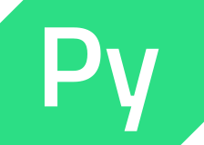
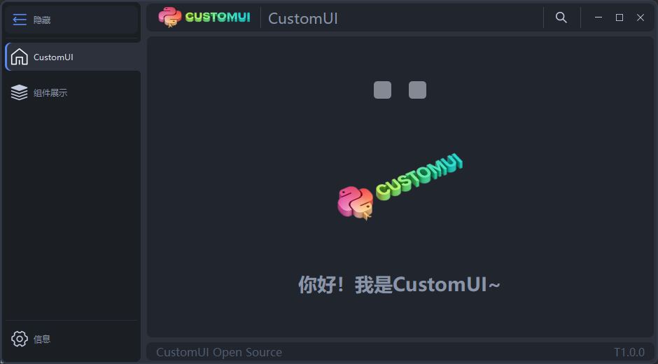
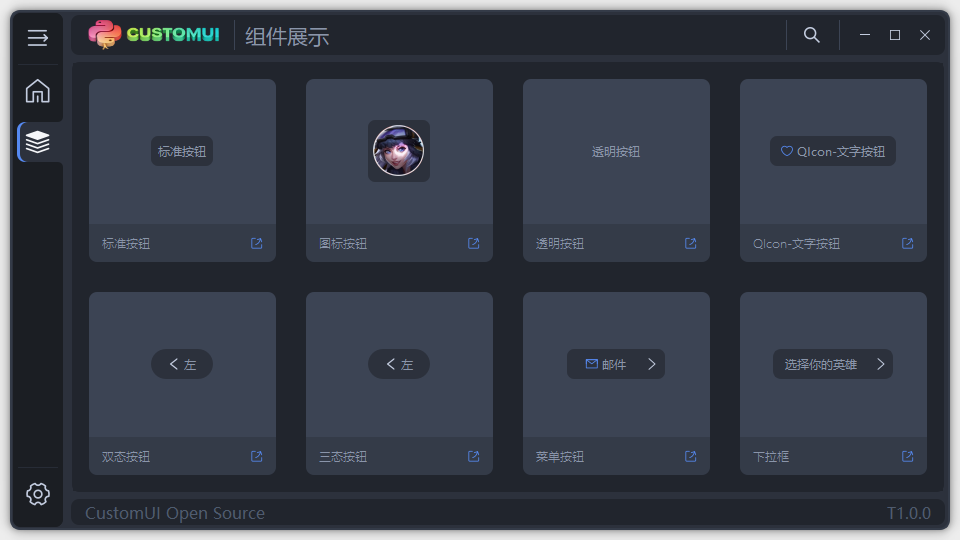
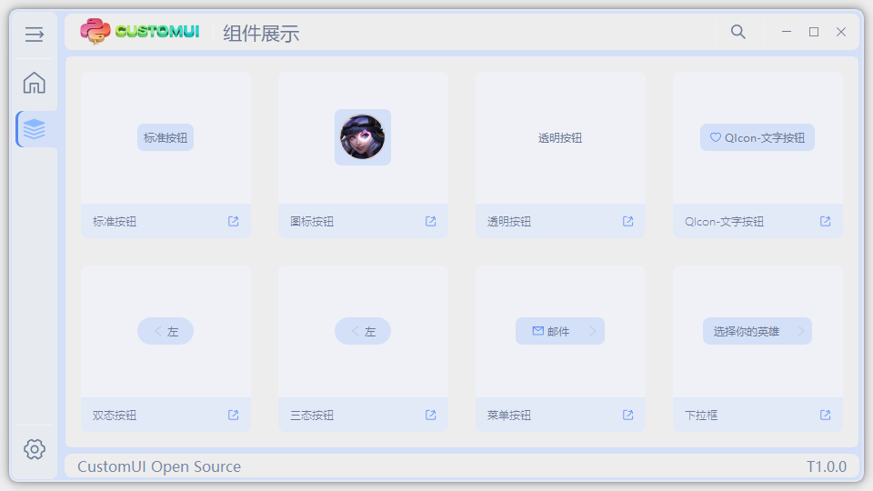
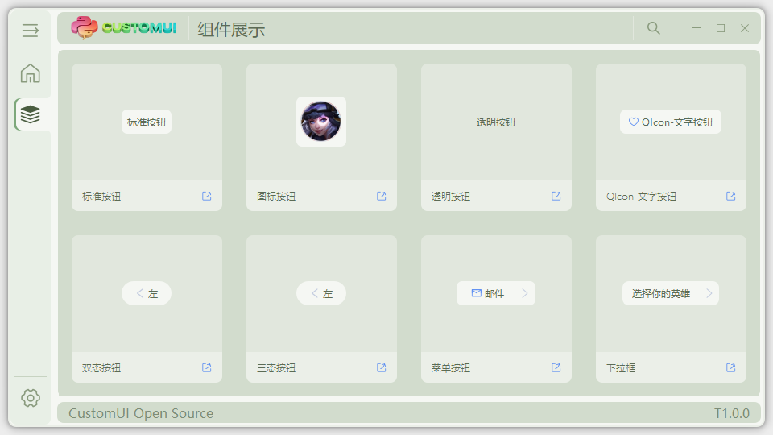
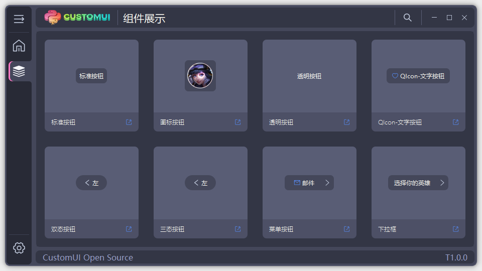

# CustomGUI  PySide6

## 简介 
本项目在上开源:[CustomGUI_Qt_For_Python](https://gitee.com/shilianlvke/CustomGUI_Qt_For_Python).

本项目在上开源:[CustomGUI_Qt_For_Python](https://github.com/shilianlvke/CustomGUI_Qt_For_Python).

PySide6 构建的现代化通用 GUI
框架，提供高度可定制的界面组件和模块化设计.

项目灵感来源于开源项目 [PyOneDark](https://github.com/Wanderson-Magalhaes/PyOneDark_Qt_Widgets_Modern_GUI).




## **核心特性**：

- 🎨 内置暗色/亮色主题切换
- 📦 预置现代化 UI 组件（按钮、输入框、表格等）
- 🛠️ 模块化架构，轻松扩展自定义组件
- 📱 响应式布局适配不同分辨率
### 主题概览
- 黑暗主题：default


  


- 明亮主题：bright


  


- 护眼主题：eye


  


- 梦幻主题：dracula


  

---

## 技术栈

- **编程语言**: Python >= 3.13
- **GUI 框架**: PySide6 >= 6.10
- **配置系统**: 标准库 dataclass 类型化模型 + PyYAML（唯一第三方配置依赖）
- **依赖管理**: uv ----> [安装教程](https://uv.doczh.com/getting-started/installation/)
   ```
  详情可查看pyproject.toml
   ```

---

## 配置系统

项目配置全部位于 `resource/customui/`，采用 **YAML 存储 + 类型化模型加载** 的架构：
配置加载框架位于 `AppCore/SYS/config/`，仅依赖 Python 标准库（YAML 解析使用
PyYAML，是唯一必要的第三方库，且被隔离在 `config/yaml_io.py` 一个文件中）。

| 目录 | 加载方式 | 暴露入口 |
| --- | --- | --- |
| `settings/` | 目录内所有 yaml 深度合并 → 强类型校验 | `AppCore.AppSettings` |
| `themes/` | 每个文件独立加载 + 校验 | `AppCore.AppThemes` |
| `languages/` | 每个文件独立加载 + 校验 | `AppCore.AppLanguages` |
| `others/` | 每个文件独立加载 | `AppCore.AppOthers` |

### 使用示例

```python
from AppCore import AppSettings, AppThemes, initialize_app_context

initialize_app_context()  # 可选：不调用则首次访问时自动惰性加载

AppSettings.theme_name            # str，强类型
AppSettings.startup_size          # (960, 540)，tuple[int, int]
AppSettings.lef_menu_size.minimum # 50，嵌套 SizeRange 模型
AppThemes[AppSettings.theme_name].data  # Attrs：属性/字典双访问
```

### 关键设计

- **类型化 Schema**：`AppCore/SYS/config/schema.py` 中每个配置域对应一个
  `@dataclass(frozen=True)` 模型（如 `AppSettingsModel`），字段即 Schema，
  加载时自动完成类型转换与校验，错误信息带字段路径
  （如 `AppSettings.lef_menu_size.minimum 必须为整数`）。
- **通用转换引擎**：`from_mapping()` 按字段类型注解递归转换原始字典，
  相当于一个极简的标准库版 pydantic；新配置只需声明 dataclass 字段。
- **线程安全惰性单例**：`get_app_context()` 双重检查锁定；模块级
  `AppSettings` 等为惰性视图，首次访问才加载，之后命中缓存。
- **独立于工作目录**：所有路径基于项目根目录解析（可用环境变量
  `CUSTOMGUI_ROOT_DIR` 覆盖），打包或任意目录启动均可正常加载。
- **单一 YAML 边界**：读写错误统一转换为 `IOErrorBoundary`
  （`YAML_FILE_NOT_FOUND` / `YAML_PARSE_ERROR` / `YAML_READ_ERROR` /
  `YAML_WRITE_ERROR`），其余框架代码与存储格式解耦。

### 新增配置

- **新增主题**：在 `resource/customui/themes/` 放置一个 yaml 文件即可，
  文件名即主题名，无需改任何代码（加载时自动校验必填颜色键）。
- **新增语言包**：在 `resource/customui/languages/` 放置 yaml 文件，
  需包含 `custom_ui` / `PAGE` / `UI` 三个分组。
- **单文件读写**：使用 `AppCore.YamlHandler`（点号路径 get/set、
  深度 merge、save，相对路径基于项目根目录）。

---

## Apps 应用模组（基座 + 模组架构）

本项目是一个 **基座（加载器）**：只提供固定页面布局、GuiCore UI 组件库、
菜单/路由/主题/语言框架——**基座本身不包含任何页面**（含欢迎页）。
全部页面由用户以「应用模组」形式放入 `Apps/` 目录，像安装模组一样被自动
发现、挂载菜单并注册页面，删除目录即卸载；清空 `Apps/` 后基座仍可启动
（内容区留空，仅剩窗口控制菜单）。

内置模组（随仓库分发，均可删除）：

- `Apps/welcome`：欢迎页（组件展示，默认页 `is_default: true`）
- `Apps/example`：最小模组范本
- `Apps/p2ptest_*`：P2PTester 业务页面（7 个独立模组）

### 模组结构

```text
Apps/<app_name>/
├── config.yml                   # 应用清单
├── resource/
│   ├── icon/app_icon.svg        # 应用图标
│   └── lang/{zh_cn,en_us}.yml   # 应用语言文件
└── gui/
    ├── main.py                  # 页面实现
    └── style.py                 # 可选：应用私有样式
```

### config.yml 字段

| 字段 | 说明 | 缺省值 |
| --- | --- | --- |
| `app_name` | 应用名（目录名） | 目录名 |
| `app_id` | 菜单插件 ID | `app.menu.<target>.<name>` |
| `button_id` | 菜单按钮 ID（路由键） | `app_<name>` |
| `page_object` | 页面控件对象名 | `<name>Page` |
| `app_icon` | 图标资源键 `icon.app.<name>.app_icon` | 同左 |
| `app_text` / `app_tooltip` | 菜单文本语言键 `language.app.<name>.*` | 同左 |
| `app_target` | 菜单挂载点（LeftMenu / TitleMenu） | `LeftMenu` |
| `show_top` / `is_active` | 菜单项位置 / 默认激活 | `true` / `false` |
| `is_default` | 是否为启动默认页 | `false` |

### 页面协议（gui/main.py 按优先级识别其一）

```python
# 1) 完全自由注册（多页面应用）
def register_plugins(registry, app): ...

# 2) PAGE：含 load_page(window) 方法的类/实例（与基座历史页面风格一致）
class MyPage:
    def load_page(self):
        page = QWidget()
        page.setObjectName("myPage")
        self.ui.load_pages.pages.addWidget(page)
        ...

PAGE = MyPage

# 3) build_page：最简形态，返回 QWidget
def build_page(app):
    page = QWidget()
    page.setObjectName(app.config.get("page_object") or "myPage")
    ...
    return page
```

`app` 为 `AppContext`：`app.config`（清单）、`app.app_dir`、`app.icon_path`、
`app.lang_text("key")`（本应用语言文本）。

### 语言

- 应用语言文件内容整体挂在 `Language.app.<app_name>` 命名空间；
- 菜单文本用 `language.app.<app_name>.<key>` 资源键引用；
- 页面内可见文本用 `Language.resolve("app.<app_name>.<key>")` 读取，
  语言切换时基座会**重建页面**，使页面内文本完整切换；
- 语言切换入口：标题栏语言按钮（中英文循环切换），
  核心在 `AppCore.SYS.module.language_module`（订阅式 LanguageManager）。

### 环境变量

- `CUSTOMGUI_APPS_DIR`：覆盖 Apps 目录位置（测试/外部模组目录用）。

---

## 主题与语言系统（订阅式模块）

主题与语言切换已制作为 **AppCore 独立模块**（`AppCore.SYS.module` 目录）：

| 模块 | 职责 |
| --- | --- |
| `theme_module` | `ThemeManager` / `get_theme_manager()`：主题状态、`apply`/`cycle`、订阅通知、遥测 |
| `language_module` | `Language`：语言包容器 + 切换协调（`apply`/`cycle`、App 语言 provider、订阅通知、遥测） |
| `color_module` | `ColorPalette`：当前调色板（主题颜色载体） |

### 主题切换

```python
from AppCore import get_theme_manager

manager = get_theme_manager()
manager.subscribe(lambda: my_widget.update_style())  # 绑定方法为弱引用订阅
manager.apply("bright")   # 更新 ColorPalette -> 通知订阅者
manager.cycle()           # eye -> bright -> default 循环
```

约定：
- 全局样式由 `GuiCore.styles.Styles` 生成，`ThemeController` 订阅管理器重建样式表；
- 自绘组件在 `paintEvent` 中**实时读取** `ColorPalette`（禁止构造时快照）；
- 内联样式/tooltip 组件实现 `update_style()` 并订阅管理器。

### 语言切换

```python
from AppCore import Language
from Guis.language_service import apply_language

Language.register_app_provider(...)     # App 语言提供者（app_loader 已注册）
Language.apply("en_us")                 # 整体切换并广播（菜单/标题栏/左列自刷新）
apply_language("en_us", window)         # 额外执行页面重建与窗口标题刷新
```

组件订阅：`CLeftMenu`/`CTitleBar`/`CLeftColumn` 等构造时订阅 `Language`，
切换后自动刷新按钮文本、提示与标题；页面内容通过**页面重建**完整切换。


---

## 日志与遥测

### 日志

- 全局入口：`AppCore.Logger`（debug / info / warning / error / critical /
  exception / tool），同时输出控制台（可选彩色）与 `logs/customgui.log`
  （1MB × 5 滚动）。
- 级别与彩色开关由 `resource/customui/settings/console.yaml` 的
  `logger_level` / `logger_color` 控制。
- 约定：错误必须记录日志（`Logger.error` / 带堆栈的 `Logger.exception`），
  不得静默吞掉异常；调试信息使用 `Logger.debug`，禁止在运行时代码中使用
  `print`。

### 遥测

- 入口：`AppCore.record_event(name, category, level, payload)` 与
  `track_timing(name)`（自动记录 `duration_ms`）。
- 落盘：`logs/diagnostics/events.jsonl`（事件流）与 `metrics.json`
  （按事件名/分类聚合计数），目录可用环境变量 `CUSTOMGUI_DIAGNOSTICS_DIR`
  覆盖。
- 遥测是「尽力而为」能力：写入失败仅降级为一条错误日志，绝不影响主程序。
- 主要事件：
  - `app.config_load` / `app.config_loaded` / `app.startup_error`
  - `app.main_window.init` / `app.main_window.ready`
  - `apps.loaded` / `app.load_error`
  - `pages.loaded`、`plugin.modules_loaded`、`plugin.page_load_error`、
    `plugin.command_error`
  - `ui.button_click` / `ui.page_switch` / `ui.theme_switch` /
    `ui.language_switch`


## 快速开始

### 环境配置

1. 克隆仓库
   ```bash
   git clone https://gitee.com/shilianlvke/CustomGUI.git
   cd CustomGUI
   
   or
   
   git clone https://github.com/shilianlvke/CustomGUI_Qt_For_Python.git
   cd CustomGUI_Qt_For_Python
   ```

2. 创建虚拟环境和安装依赖
   ```bash
   # Windows PowerShell(项目路径下)
   1. uv python install 3.13 (下载python3.13)
   2. uv python pin 3.13 (将python版本固定到3.13)
   3. uv venv (创建虚拟环境)
   4. .\.venv\Scripts\Activate (激活虚拟环境)
   4. uv sync (同步依赖包)
   ```

3. *安装可选硬件依赖（仅 Windows 串口/HID/网卡扫描功能需要）
   ```bash
   uv sync --extra windows-hardware
   ```

### 运行示例

```bash
uv run python main.py
```

---

### 应用打包

使用 [auto-py-to-exe](https://github.com/brentvollebregt/auto-py-to-exe) 生成独立可执行文件：

1. 安装打包工具
   ```bash
   uv add auto-py-to-exe
   ```

2. 启动图形化打包向导(激活环境后)
   ```bash
   auto-py-to-exe
   ```

**打包配置建议**：
• 选择 `main.py` 作为主脚本
• 启用 `One Directory` 打包模式
• 添加 `ui` 和 `themes` 目录到附加文件

### CI/CD 发布流水线

- `CI` 工作流：用于 lint + 测试
- `Release Build` 工作流：
   - 支持 Windows 打包
   - 推送 `v*` tag 自动触发
   - 自动上传构建产物到 GitHub Release
- `Release to Gitee` 工作流：GitHub Release 发布后自动同步到 Gitee（双平台版本发布）：
   - 复用 `Release Build` 产物：创建同名 Gitee Release 并上传 zip 附件，同名附件自动跳过、可重复执行
   - 也可手动触发（指定 tag 补发，或留空使用最新 Release）
   - 一次性配置：在 Gitee「设置 → 私人令牌」生成令牌；在本仓库
     `Settings → Secrets and variables → Actions` 中添加
     `GITEE_TOKEN`（Secret），可选 `GITEE_OWNER` / `GITEE_REPO`（Variables，
     缺省使用 GitHub 同名仓库）
   - 实现：`.github/workflows/gitee-release.yml` + `scripts/publish_gitee_release.py`
- `Gitee Go` 原生流水线（可选，配置文件 `.workflow/ReleasePipeline.yml`）：
   - Gitee Go 读取仓库根目录 `.workflow/` 下的 YAML，提交即被平台自动发现（无需在平台粘贴）
   - `v*` tag 推送自动触发：质量检查（ruff + pytest）→ Linux 打包 → 复用
     `scripts/publish_gitee_release.py` 通过 Gitee API 创建 Release 并上传 zip 附件
     （幂等：同 tag 复用 Release、同名附件跳过）
   - 一次性配置：在 Gitee「设置 → 私人令牌」生成令牌，到仓库
     「管理 → 环境变量管理」添加密文变量 `GITEE_TOKEN`（与 GitHub 同步工作流共用）
   - 限制：Gitee Go 构建环境为 Linux 容器（内置 Python 最高 3.9），模板内通过 uv 安装
     3.13 解释器，产出的为 **Linux 安装包**；Windows 安装包仍由 GitHub Actions 构建并
     经 `Release to Gitee` 工作流同步——两条链路互补
   - 说明：平台官方「Gitee Release」插件的 step 标识未公开且附件仅支持已提交仓库的
     文件，故模板直接复用发布脚本走 API，不依赖该插件

### 文档自动化（架构图/API）

本地生成文档：

```bash
uv run python scripts/generate_docs.py
```

生成目录（ARCHITECTURE.md / API.md / LEGACY_COMPATIBILITY.md）：

```text
Docs/
```

CI 工作流包含「文档同步检查」：每次提交都会重新生成文档并与仓库内
`Docs/` 对比，不一致则失败——修改核心代码或脚本后请记得重新生成并提交
`Docs/`。

### 打包脚本

```bash
# 构建独立应用（PyInstaller，含 resource/ReadMeRes/Apps 应用模组）
uv pip install "pyinstaller>=6.10.0"
uv run python scripts/build_package.py

# 将构建产物压缩为 zip（dist/release/）
uv run python scripts/archive_dist.py <target-name>
```

### 迁移与兼容状态（2026-10）

- 历史兼容入口已全部移除：`config_module`、`languge_module`、`ui_mian`、`folder_tools`、`settings_module`、`resource_locator`、`locator`、`loader`
- 规范入口：
   - 配置：`AppCore.AppSettings` / `AppCore.get_app_context()`（内部实现：`AppCore.SYS.config`）
   - 单文件配置读写：`AppCore.YamlHandler` / `AppCore.JsonHandler`
   - 路径解析：`AppCore.SYS.config.paths`
   - 语言模块：`AppCore.SYS.module.language_module`
   - 加载窗口：`Guis.windows.loading_window.ui_main`
- 兼容与下线记录：`Docs`

---

## 开发指南

1. **项目结构**
   ```
   CustomGUI/
   ├── AppCore/         # 程序核心（配置/日志/遥测/插件协议）
   ├── GuiCore/         # UI 核心组件库
   ├── Guis/            # 基座界面框架（布局/欢迎页/App 加载器/语言服务）
   ├── Apps/            # 应用模组（业务内容，见「Apps 应用模组」章节）
   ├── resource/        # 配置文件/资源
   ├── main.py          # 主入口
   └── pyproject.toml   # 项目配置信息
   ```

2. **自定义主题**
   修改 `resource\customui\themes` 中的颜色配置，或新增配置文件，参考示例代码：
   `resource\customui\themes\default.yaml`（详见上方「配置系统」章节）

3. **扩展组件**
   参考示例代码：
   ```
   GuiCore\customui\
   GuiCore\widgets\
   ```

4. **代码质量门禁（推荐）**
   在提交前执行：
   ```bash
   uv run ruff check .
   uv run pytest -q
   ```

   增量开发时可先做“改动文件定向检查”，再跑全量：
   ```bash
   uv run ruff check <changed-files>
   uv run pytest -q
   ```

   可选：自动修复部分可修复问题（如未使用导入）：
   ```bash
   uv run ruff check . --fix
   ```

5. **本地发布前最小检查清单**
   - `uv run ruff check .` 通过
   - `uv run pytest -q` 通过
   - `uv run pytest -q tests/test_legacy_import_policy.py` 通过（防止回退到历史入口）
   - `uv run python scripts/generate_docs.py` 后文档无差异（或已提交文档更新）

---

## 参与贡献

欢迎通过 Issue 和 PR 参与项目开发，流程如下：

1. Fork 本仓库
2. 创建功能分支 (`git checkout -b feature/AmazingFeature`)
3. 提交代码 (`git commit -m 'Add some AmazingFeature'`)
4. 推送分支 (`git push origin feature/AmazingFeature`)
5. 发起 Pull Request

请确保代码符合 [PEP8](https://peps.python.org/pep-0008/) 规范，并通过 `ruff` 与 `pytest` 检查。

---

## 许可证

本项目采用 [MIT License](LICENSE)，请自由使用并保留原始作者信息。

## 代码分支

   ```
main: 主分支-稳定版本
   ```

## 常用指令
### Windows
   ```PowerShell 清除Python产生的所有__pycache__文件夹
Get-ChildItem -Recurse -Directory -Filter '__pycache__' | Remove-Item -Recurse -Force
   ```