# 架构说明

本文描述 CustomGUI 当前（内测版 `0.6.0`）的代码组织、启动链路与扩展点。
文档为手工维护，与源码同步；断言行为以 `tests/` 为准。

## 1. 设计目标

- **可被依赖**：宿主项目只接触 `customgui`、`customgui.appcore`、`customgui.window` 三个门面，
  不必了解内部装配细节。
- **单向依赖**：逻辑层不认识 UI，组件层不认识装配层，装配层只能用逻辑层的公开面。
- **装在别处也能跑**：源码、wheel、PyInstaller 三种形态下资源路径一致，不依赖当前工作目录。
- **应用自包含**：一个应用目录带走自己的页面、图标、语言与品牌资源，删除目录即下线。

## 2. 分层

| 层 | 包 | 职责 | 禁止 |
| --- | --- | --- | --- |
| 逻辑层 | `customgui.appcore` | 配置、路径、主题、语言、令牌、插件协议、日志、遥测、错误边界、存储 | import `guicore` / `guis` |
| 组件层 | `customgui.guicore` | 组件实现、窗口部件、QSS 生成、字体、后台任务、回调守卫 | import `guis` |
| 装配层 | `customgui.guis` | 主窗口组装、页面栈、应用装载、语言服务、按钮路由 | 使用 `appcore.sysx.*` 深层模块 |
| 门面 | `customgui` / `window` / `config` | 收敛稳定 API：`configure` / `get_app_context` / 命令 | 写业务逻辑 |

约束由 `tests/test_architecture_boundaries.py` 用 AST 扫描 import 根执行，违反即测试失败。

```text
apps/*  ──────────────┐
                      ▼
              customgui.window  (门面)
                      │
                      ▼
              customgui.guis    (装配)
                      │
                      ▼
             customgui.guicore  (组件)
                      │
                      ▼
             customgui.appcore  (逻辑)
                      │
                      ▼
        _resources/customui (默认主题/语言/设置/图标)
```

## 3. 包地图

### 窗口入口的三层职责

仓库里有三处名字含 `window`，职责不同，扩展时不要混用：

| 入口 | 角色 | 稳定性 |
| --- | --- | --- |
| `customgui.window` | 宿主唯一门面：窗口骨架、应用装载、语言服务的再导出 | **稳定**，宿主只依赖这里 |
| `customgui.guicore.window` | 可复用窗口部件（`CWindow` / `CTitleBar` / `CLeftMenu` 等）与壳层组件 | 组件层稳定；`window/window/` 内部实现不保证 |
| `customgui.guis.windows` | 主窗口装配、页面栈、按钮路由 | **内部**，宿主通常不直接依赖 |

`customgui.guicore` 为方便宿主一次性导入而再导出了较多符号；稳定 API 的判定以
[API.md](API.md) 的“稳定面一览”为准，其余符号视为组件内部约定。

### appcore

| 模块 | 内容 |
| --- | --- |
| `sysx/config/registry.py` | 配置注册表：按资源层装载 `settings` / `themes` / `languages`，schema 校验，线程安全惰性单例；`get_app_context()`、`AppSettings` / `AppThemes` / `AppLanguages` / `AppOthers` |
| `sysx/config/paths.py` | `resource_roots()` / `apps_root()` / `data_root()` / `find_resource()` / `resolve_path()` / `iter_files()` / `iter_file_layers()` |
| `sysx/config/schema.py` | 强类型模型：`AppSettingsModel`、`ThemeModel`、`PageTransitionSettings`、`FeedbackSettings`、`OverlaySettings`、`PanelSettings`、`ButtonSettings` |
| `sysx/config/mapping.py` | `Attrs`（属性/字典双访问）、`deep_merge()`、`to_attrs()` / `to_dict()` |
| `sysx/config/yaml_io.py` | YAML 读写与统一错误码 |
| `sysx/modules/theme_module.py` | `ThemeManager`：`apply(name, accent=None)`、`cycle()`、`subscribe()` / `unsubscribe()`、强调色推导 |
| `sysx/modules/token_module.py` | `DesignTokens`：colors / typography / spacing / radius / border / size 六组令牌 |
| `sysx/modules/language_module.py` | `Language`：`update()` / `replace()` / `resolve()` / `apply()` / `register_app_provider()`；`LANGUAGE_OPTIONS` 惰性发现 |
| `sysx/modules/plugin_module.py` | `PluginRegistry`、`MenuPlugin`、`PagePlugin`、`CommandPlugin`，支持懒加载页面 |
| `sysx/modules/app_protocol.py` | 协议 v2：`AppPlugin` / `AppPage` / `AppPluginError`、`PROTOCOL_VERSION` |
| `sysx/modules/error_module.py` | `AppError` 与三层错误边界（Domain / IO / UI） |
| `sysx/modules/telemetry_module.py` | `record_event()` / `track_timing()` / `read_recent_events()` |
| `sysx/modules/logger_module.py` | 分级日志，输出到数据根 `logs/` |
| `sysx/handlers/yaml_handler.py` | `YamlHandler`：加载/合并/保存单个 YAML |
| `sysx/common/static_func.py` | `PathFactory`（图标/图片/ICO 解析）、`PicFixFactory` |
| `app/main_window_use_cases.py` | `MainWindowButtonUseCase` / `ButtonDecision`：按钮 → 动作的纯逻辑映射 |
| `tool/storage.py` | 原子写（`fsync` + `os.replace` + `.bak` 回退） |

### guicore

| 模块 | 内容 |
| --- | --- |
| `custom_ui/` | 91 个组件 + 3 个模型/枚举，按 `button` / `line_edit` / `data` / `menu` / `display` / `overlay` / `feedback` / `panels` / `layout` / `media` / `chart` / `upload` / `scroll` / `picture` / `card` / `div` / `tooltip` / `page_transition` 分包 |
| `window/` | `CWindow`、`CTitleBar`、`CLeftMenu`、`CLeftColumn`、`CTopColumn`、`CBottomColumn`、`CGrips`、`CCredits` 与壳层 `CAppTopbar` / `CAppMenu` / `CAppConfigurator` |
| `styles.py` | 令牌 → QSS；`Styles()` 生成全局样式表，`region_card_background()` 提供区域卡片底色 |
| `fonts.py` | `install_fonts()` / `install_system_fonts()`，解决 offscreen / 远程会话的 CJK 豆腐块 |
| `callbacks.py` | `safe_callback()` / `ui_callback()` / `single_shot()` / `is_deleted_qt_error()` |
| `task.py` | `TaskWorker` / `WorkerSignals` / `run_task()` / `active_tasks()`，带取消协议 |
| `app_ui/` | 应用级 UI 片段：`CPreviewPage` 预览页基类（页面外壳 + 分区卡片 + 语言入口） |

### guis

| 模块 | 内容 |
| --- | --- |
| `app_loader.py` | 编排层：`register_app()`、`load_apps()`、`load_app_handles()`、`get_app_handle()`、`reset_apps_cache()` |
| `app_manifest.py` | 清单与发现：`discover_app_dirs()`、`load_app_manifest()`、协议/入口校验、应用语言加载 |
| `app_namespace.py` | 私有命名空间 `_customgui_apps`：MetaPathFinder 与应用模块导入 |
| `app_context.py` | `AppContext`（`lang_text` / `resource` / `import_module`）与 `AppHandle` |
| `app_v2.py` | 协议 v2：`AppPlugin` / `AppPage` → `MenuPlugin` + `PagePlugin` 的注册转换 |
| `app_state.py` | 应用目录、句柄与加载标志的集中状态（解开 manifest ↔ loader 的循环依赖） |
| `windows/main_window/ui_main.py` | `UiMainWindow`：标题栏 / 左菜单 / 页面栈 / 右列 / 版权栏的静态布局 |
| `windows/main_window/setup_main_window.py` | `SetupMainWindow`：信号连接、按钮总线、grips、初始页面 |
| `windows/main_window/controller.py` | `MainWindowController` + `PageRouterController`：按钮路由、页面切换、主题循环 |
| `windows/main_window/registry.py` | 页面注册表：`load_registered_pages(eager=False)`、`ensure_registered_page()`、`get_page_routes()` |
| `pages/main_pages.py` | `Ui_MainPages` 页面栈容器 |
| `language_service.py` | `apply_language()` / `switch_language()`：广播语言变化 → 重建页面 → 刷新标题 |

## 4. 启动时序

`customgui run`（`cli.py`）与宿主 `main.py` 走的是同一条链路：

1. `customgui.configure(...)` 写入全局配置（可选；也可用环境变量）。
2. `get_app_context()` 首次加载配置上下文：按资源层深合并 `settings` / `themes` / `languages`，做 schema 校验。
3. `ColorPalette.update(AppThemes[AppSettings.theme_name].data)`、`Language.update(AppLanguages[...].data)`
   装载主题色与基座语言。
4. 创建 `QApplication`，设置 `Fusion` 样式与窗口图标（`PathFactory.set_ico(AppSettings.logo)`）。
5. `load_apps()` 发现 `apps/*/config.yml`，逐个 `register_app()`：
   校验 `app_name` / `core`、解析图标、注入应用语言、注册菜单插件、按 `protocol` 装载页面。
6. `UiMainWindow.setup_ui(window)` 搭骨架，`SetupMainWindow.setup_gui(window)` 连信号。
7. `MainWindowController(window)` 注册按钮路由；默认页立即构建，其余页面在首次导航时构建（懒加载）。
8. `app.exec()` 进入事件循环。

```mermaid
flowchart LR
    A[configure] --> B[get_app_context]
    B --> C[ColorPalette / Language]
    C --> D[QApplication]
    D --> E[load_apps]
    E --> F[register_app x N]
    F --> G[UiMainWindow.setup_ui]
    G --> H[SetupMainWindow.setup_gui]
    H --> I[MainWindowController]
    I --> J[默认页构建 + 显示]
```



## 5. 配置与资源解析

- **优先级**：`configure()` 显式参数 > `CUSTOMGUI_*` 环境变量 > 内置默认值。
- **资源根顺序**：`resource_dirs` / `CUSTOMGUI_RESOURCE_DIR` → 各应用 `<app>/brand/` → 包内 `_resources/`。
- **配置是深合并**：`settings/` / `themes/` / `languages/` 下同名 YAML 逐层 `deep_merge`，
  品牌层只写要改的键；其他资源（图标/图片/字体）同名整份替换。
- **路径解析**：`find_resource()` 只在资源根里找；`resolve_path()` 找不到时回落到包内稳定位置，
  便于报错与写操作定位。运行时不得使用 `os.getcwd()`（有测试守）。
- **可写数据**：日志、遥测与用户配置写到 `data_root()`（默认程序运行根目录，
  可用 `configure(data_dir=...)` / `CUSTOMGUI_DATA_DIR` 覆盖），绝不写安装目录或用户系统目录。

## 6. 应用装载与页面路由

- 发现：`discover_app_dirs()` 只认含 `config.yml` 的子目录，按名称排序。
- 校验：`app_name` 必须等于目录名；`protocol` 只能是 `1` / `2`；违规抛 `AppPluginError`（带错误码）。
- 命名空间：应用模块挂到私有包 `_customgui_apps.<name>`，支持应用内跨目录相对导入。
- 注册：一个应用可声明多个页面（v2 的 `pages()` 或 v1 的 `register_plugins`），
  每个页面注册为 `PagePlugin`，菜单项注册为 `MenuPlugin`。
- 路由：`registry.get_page_routes(language)` 把 `button_id` 映射到 `(page_object, title)`；
  `ensure_registered_page()` 在导航前按需构建页面；`MainFunctions.set_page()` 负责过场动画。
- 语言切换：`apply_language()` 先广播（标题栏/菜单/版权栏自刷新），再整体重建页面栈，
  只构建默认页与当前页，避免实例化全部隐藏页面。

## 7. 主题与令牌（Windows Fluent Design）

- **字体**：`Segoe UI Variable`；标题 15pt、副标题 11pt、正文 10pt；小号标签 9pt / 600。
- **圆角**：标准控件（按钮/输入框/菜单项）4px；窗口、卡片、面板、对话框、菜单 8px；
  提示气泡 8px。胶囊（`rounded=True`、Badge、Chip、开关）保留全圆角。
- **高度**：控件三档 28 / 32 / 40px；md 32px 为默认密度；列表行高 36px。
- **状态**：悬停 = 常态底色叠加正文色 6%，按下 10%；输入框聚焦为 2px 强调色底边；
  按钮键盘聚焦为 2px 强调色描边；禁用态使用中性底 + 弱化文字（38% 内容色），
  不再整体降低语义色透明度。
- **语义色**：primary / info / help 使用主题强调色；success / warn / danger 使用主题的
  `custom_green` / `custom_yellow` / `custom_red`，四套主题各自解析，不写死 Aura 色阶。
- **阴影**：按钮默认平面，`raised` 为可选浮起；菜单、对话框、Toast、Tooltip 使用
  短距离、低透明度的 Fluent 高度阴影。
- **描边**：控件描边比卡片描边更深（约正文色 26%–42%），保证浅色主题下可辨认。

`ThemeModel` 是一组必填颜色 + 可选颜色；`ThemeManager.apply()` 把主题色写入 `ColorPalette`，
并按强调色推导 hover / pressed。`Styles()` 从 `DesignTokens` 生成全局 QSS；自绘组件在
`paintEvent` 中实时读取令牌，**不在构造时快照色值**，否则主题热切换会出现新旧配色混搭。
`ThemeManager.subscribe(callback)` 支持弱引用/控件销毁自动解绑，切换后只 `update()`，
不重建整窗样式表。

## 8. 错误边界与遥测

- `AppError` 携带 `code`、`layer`、`details`；`DomainErrorBoundary` / `IOErrorBoundary` / `UIErrorBoundary`
  把底层异常统一成带错误码的领域异常，`to_user_message()` 负责转成可展示文案。
- `record_event(name, category=..., level=..., payload=...)` 写入诊断目录；
  `track_timing()` 记录耗时；`read_recent_events()` 供诊断页/测试读取。
- UI 回调统一走 `guicore.callbacks`，控件已析构时不再刷异常。

## 9. 架构守卫与测试

| 测试 | 守什么 |
| --- | --- |
| `test_architecture_boundaries.py` | 三层依赖方向、公开面导入、私有命名空间、禁止 `parents[N]` |
| `test_no_cwd_runtime_dependency.py` | 运行时代码不得调用 `os.getcwd()` |
| `test_removed_entry_points.py` | 已下线入口不得复活 |
| `test_naming_consistency.py` | 包/模块命名规范 |
| `test_language_coverage.py` | 四套语言键逐键对齐 |
| `test_preview_apps.py` | 10 个示例应用能装载并完成一次绘制 |

全量用例在 `QT_QPA_PLATFORM=offscreen` 下运行（`tests/conftest.py` 已设）。
`test_preview_apps.py` 同时校验页面 `objectName` 与清单 `page_object` 一致——页面跳转靠这个字符串定位。
用例数与告警数随代码变化，以 `uv run pytest` / `uv run ruff check src tests` 的实际输出为准；
这两个命令也是 `.workflow/QualityGate.yml` 在 PR 阶段执行的判定标准。

## 10. 扩展点

| 想做的事 | 入口 |
| --- | --- |
| 加一个页面 | `apps/<name>/` + 清单 + `gui/main.py`（见 [PLUGIN.md](PLUGIN.md)） |
| 换品牌配色/图标 | `configure(resource_dirs=[...])` 或 `<app>/brand/customui/` |
| 加主题 | `_resources/customui/themes/<name>.yaml`，重启后出现在主题循环 |
| 加语言 | `_resources/customui/languages/<code>.yaml`，`LANGUAGE_OPTIONS` 自动发现 |
| 调窗口/动画/提示参数 | `_resources/customui/settings/window.yaml` |
| 接管按钮行为 | `MainWindowButtonUseCase.ACTION_MAP` 或自定义 `controller` |
| 后台任务 | `guicore.run_task()` + `TaskWorker` |
| 遥测落盘 | `record_event()` / `track_timing` |

## 11. 已知架构债

内测阶段明确保留、但需要在正式版前处理的问题：

1. **兼容壳**：`CLineEdit` / `CPushButton`、协议 v1（`PAGE` / `build_page`）、旧 `resource/`
   布局仍保留，增加认知成本。三者都有真实调用方，删除要连带改应用与文档，
   留到正式版前一次性处理。

内测期已经清掉、留档备查的几项（原「已知架构债」1/2/4/5/6 条）：

- **相对路径**：`--apps-dir` / `--data-dir` 在 CLI 入口统一 `Path(...).resolve()`，
  `install-demo` / `examples --copy` 在源码树回落到仓库 `apps/` 与 `examples/`；
  版本号改为以 `_version.py` 为唯一来源，不再优先读 site-packages 里的旧 wheel。
- **超大模块**：`custom_ui/data/tree.py`、`data/table.py` 按「角色常量 / 列定义 / 模型 /
  委托 / 视图」拆分，`guis/app_loader.py` 拆成编排 + 清单 + 命名空间 + 上下文 + 协议 v2 +
  状态六个模块，对外导出面不变。
- **应用脚手架**：10 个预览应用统一继承 `guicore/app_ui/page.py` 的 `CPreviewPage`。
- **死代码**：`guis/windows/loading_window/`、`appcore/tool/{device,Net,verify}.py`、
  整文件 skip 的 `tests/test_example_paradigm.py`、`guicore/app_ui/dialog/` 的重复
  `CDialog` 均已删除，`windows-hardware` 可选依赖与对应的多语言键一并移除。

