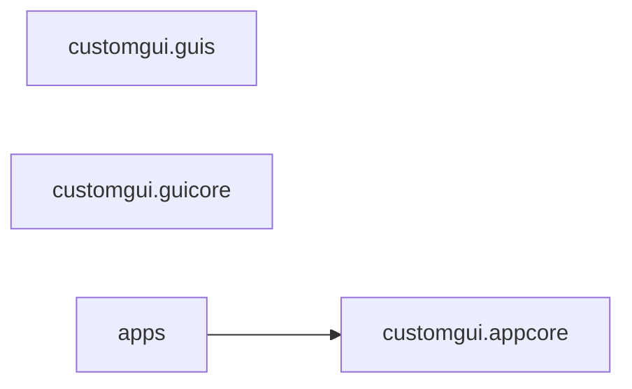

# Architecture

This file is auto-generated by scripts/generate_docs.py.

## High-Level Layers

- customgui.appcore: app context, config loading, theme/language/telemetry modules, plugin protocol
- customgui.guis: base window framework, welcome page, app loader, language service
- customgui.guicore: reusable UI components and style system
- apps: self-contained app modules (discovered and mounted by the base)

## Dependency Graph

